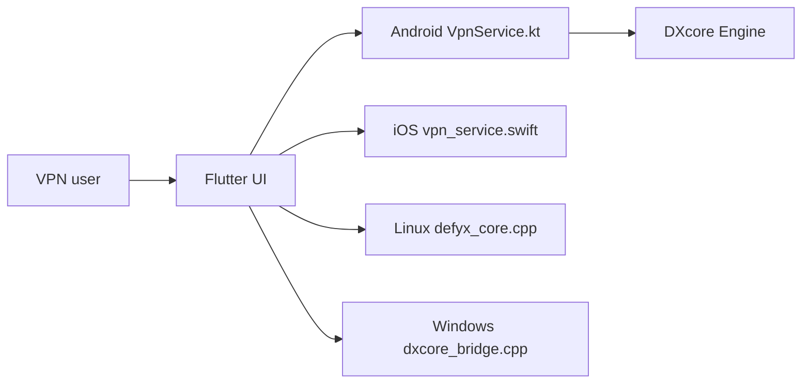

# UnboundTechCo/defyxVPN

> Open source Flutter VPN client, powered by the DXcore engine, to bypass censorship.

## The problem
Accessing a filtered Internet requires juggling several protocols and manual settings.

## What it actually does
One-tap Flutter application, built on DXcore (Warp, Psiphon, Warp-in-Warp, Xray, Outline and proprietary protocols). Native VPN services on Android, iOS and macOS, desktop channels for Linux and Windows (system proxy, tray icon), speed test.

## How it is wired


## Trying it
```bash
flutter pub get
flutter run
make build-ios
```

## Cost and gotchas
Free. Flutter ≥ 3.7, Xcode for iOS/macOS. The DXcore sources and several native implementations were not included in the analysis.

## What it is not
Not an enterprise VPN that can be audited end to end: the DXcore engine includes proprietary protocols that are not detailed. "Relatively smart" is the README's own wording.

## Alternatives
No alternative named in the README.

## For you
Ignore: consumer privacy tool, outside the data/AI scope, with a partly opaque engine.
