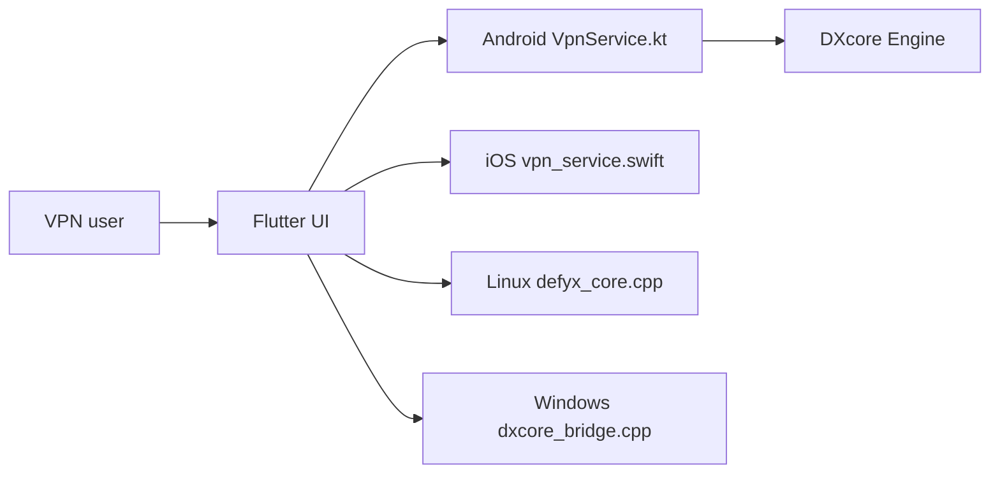

# UnboundTechCo/defyxVPN

> Client VPN Flutter open source, alimenté par le moteur DXcore, pour contourner la censure.

## Le problème
Accéder à un Internet filtré exige de jongler avec plusieurs protocoles et réglages manuels.

## Ce que ça fait vraiment
Application Flutter à connexion en un geste, qui s'appuie sur DXcore (Warp, Psiphon, Warp-in-Warp, Xray, Outline et protocoles propriétaires). Services VPN natifs Android, iOS et macOS, canaux de bureau Linux et Windows (proxy système, barre d'état), test de vitesse.

## Comment c'est branché


## Essayer
```bash
flutter pub get
flutter run
make build-ios
```

## Coût et pièges
Gratuit. Flutter ≥ 3.7, Xcode pour iOS/macOS. Les sources DXcore et plusieurs implémentations natives n'étaient pas incluses dans l'analyse.

## Ce que ce n'est pas
Pas un VPN d'entreprise auditable de bout en bout : le moteur DXcore inclut des protocoles propriétaires non détaillés. « Relativement intelligent » est la formule du README.

## Alternatives
Aucune alternative nommée dans le README.

## Pour toi
Ignorer : outil grand public de confidentialité, hors périmètre data/IA, avec un moteur partiellement opaque.

