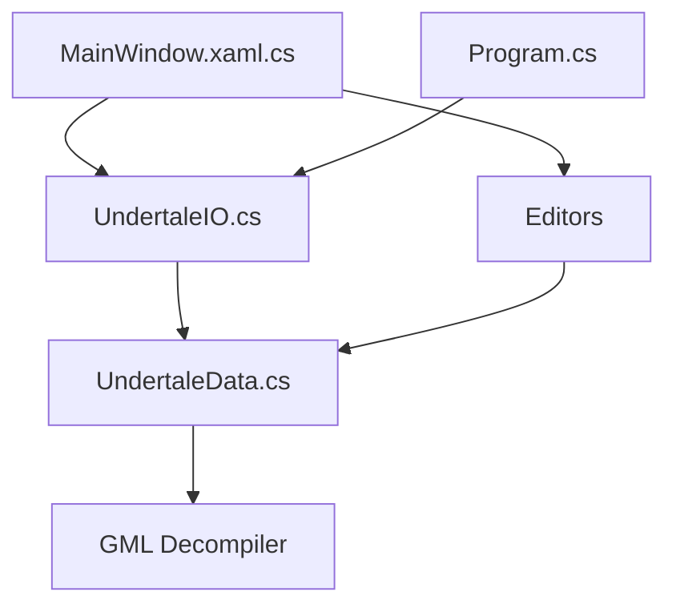

# UnderminersTeam/UndertaleModTool

> Editor, decompiler and data extractor for modding Undertale and other GameMaker games.

## The problem
GameMaker data files (data.win) are binary and opaque: modding is impossible without a dedicated tool.

## What it actually does
Reads and rewrites the data file byte for byte, with a value editor, a room editor, a GML decompiler and compiler, and C# scripts. GUI version (Windows) and CLI. The core is extracted into a library (UndertaleModLib).

## How it is wired


## Trying it
```bash
dotnet publish
```

## Cost and gotchas
No official GUI on macOS/Linux (CLI, port in progress or Wine). Building the GUI requires Windows and the .NET 10 SDK; clone with the submodules.

## What it is not
Not a general-purpose reverse-engineering tool: it targets the GameMaker format. YYC is not supported for code editing.

## Alternatives
No alternative named in the README.

## For you
Ignore: game modding tooling, unrelated to your work.
