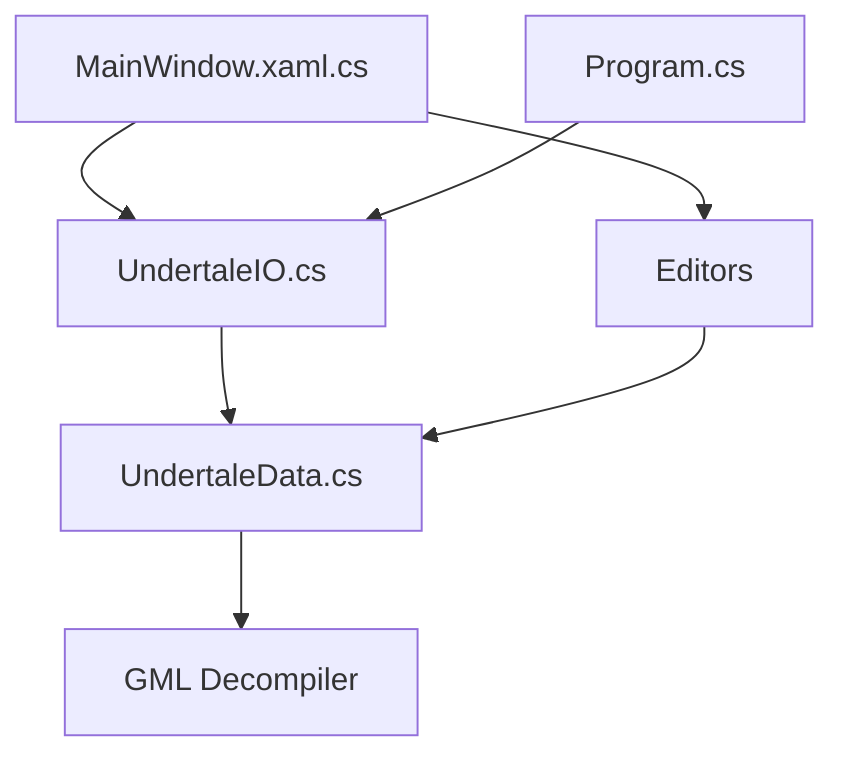

# UnderminersTeam/UndertaleModTool

> Éditeur, décompilateur et extracteur de données pour modder Undertale et d'autres jeux GameMaker.

## Le problème
Les fichiers de données GameMaker (data.win) sont binaires et opaques : impossible de modder sans outil dédié.

## Ce que ça fait vraiment
Lit et réécrit à l'octet près le fichier de données, avec un éditeur de valeurs, un éditeur de salles, un décompilateur et compilateur GML, et des scripts C#. Version GUI (Windows) et CLI. Le coeur est extrait dans une bibliothèque (UndertaleModLib).

## Comment c'est branché


## Essayer
```bash
dotnet publish
```

## Coût et pièges
Pas de GUI officielle sous macOS/Linux (CLI, port en cours ou Wine). Compiler le GUI exige Windows et le SDK .NET 10 ; cloner avec les sous-modules.

## Ce que ce n'est pas
Pas un outil généraliste de reverse engineering : il vise le format GameMaker. Le YYC n'est pas géré pour l'édition de code.

## Alternatives
Aucune alternative nommée dans le README.

## Pour toi
Ignorer : de l'outillage de modding de jeux, sans rapport avec ton métier.

