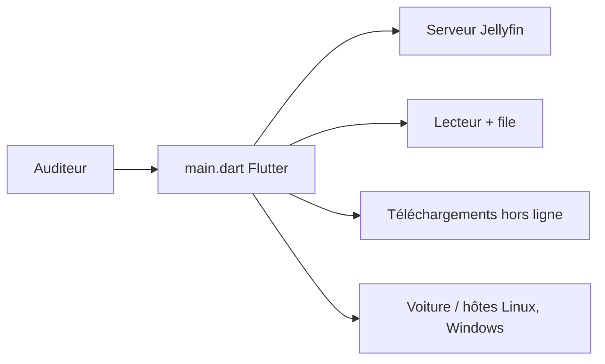

# UnicornsOnLSD/finamp

> Free music player for a Jellyfin server, on Android, iOS and desktop.

## The problem
Listening to your own Jellyfin music library requires a convenient client, with offline download.

## What it actually does
Connects to a Jellyfin server (Navidrome and Lyra work without active support) to stream or download music. Gapless playback, transcoding, lyrics, ReplayGain normalization, dynamic colors, Android Auto and CarPlay, listening report and AudioMuse mixes. Flutter interface; DBus bridge on Linux for the accent color.

## How it is wired


## Trying it
```bash
yay -S finamp
```
Otherwise: Google Play, F-Droid, or the APK from the releases.

## Cost and gotchas
Free. A Jellyfin server is essential. On Windows, install a self-signed certificate before the `.msix`. 391 open issues.

## What it is not
Not a streaming service nor supplied music: you bring your own library.

## Alternatives
No alternative named in the README.

## For you
Ignore: a music client, unless you host Jellyfin at home.
