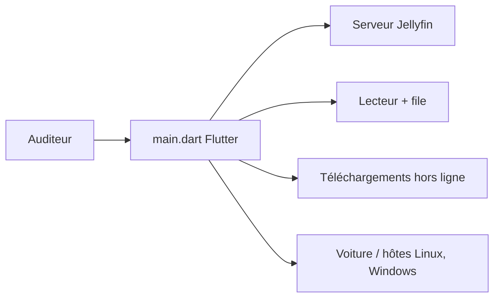

# UnicornsOnLSD/finamp

> Lecteur de musique gratuit pour serveur Jellyfin, sur Android, iOS et bureau.

## Le problème
Écouter sa propre bibliothèque musicale Jellyfin demande un client pratique, avec téléchargement hors ligne.

## Ce que ça fait vraiment
Se connecte à un serveur Jellyfin (Navidrome et Lyra fonctionnent sans support actif) pour streamer ou télécharger la musique. Lecture sans coupure, transcodage, paroles, normalisation ReplayGain, couleurs dynamiques, Android Auto et CarPlay, rapport d'écoute et mixes AudioMuse. Interface en Flutter ; pont DBus sous Linux pour la couleur d'accent.

## Comment c'est branché


## Essayer
```bash
yay -S finamp
```
Sinon : Google Play, F-Droid, ou l'APK depuis les releases.

## Coût et pièges
Gratuit. Un serveur Jellyfin est indispensable. Sous Windows, installer un certificat auto-signé avant l'`.msix`. 391 issues ouvertes.

## Ce que ce n'est pas
Pas un service de streaming ni de la musique fournie : tu apportes ta bibliothèque.

## Alternatives
Aucune alternative nommée dans le README.

## Pour toi
À ignorer : client musical, sauf si tu héberges Jellyfin chez toi.

