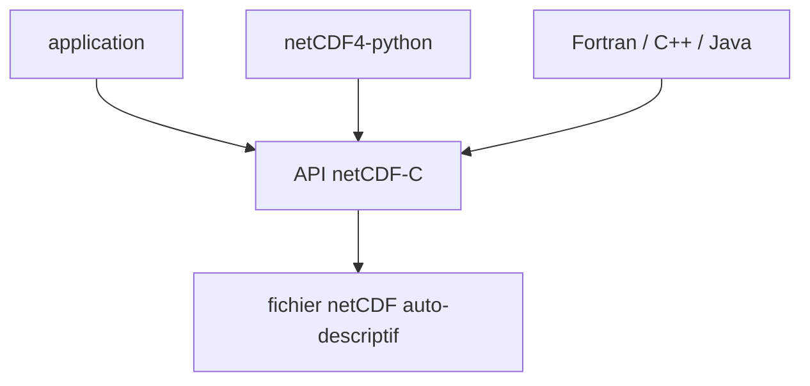

# Unidata/netcdf-c

> C library and netCDF format for storing and sharing multidimensional scientific data.

## The problem
Scientific data circulates in application-specific formats that are not portable between machines.

## What it actually does
Provides an interface and a self-describing, portable file format with direct access (reading a subset without reading everything) and extensibility (appending without copying). This distribution is in C; Java, Fortran, Python and C++ are separate Unidata distributions. Installation goes through CMake or Autoconf.

## How it is wired
Simplified diagram based on the sheet, no diagram provided.

## Trying it
The README gives no command: it points to the INSTALL file and the CMake and Autoconf guides.

## Cost and gotchas
Free, BSD-3-Clause license. Built in C; 293 open issues. The README does not detail usage.

## What it is not
It is not a database or a visualization tool: it is a file access layer.

## Alternatives
No alternative named in the README.

## For you
Adopt if you handle multidimensional climate or geophysical data: it is the reference building block behind netCDF4-python.
