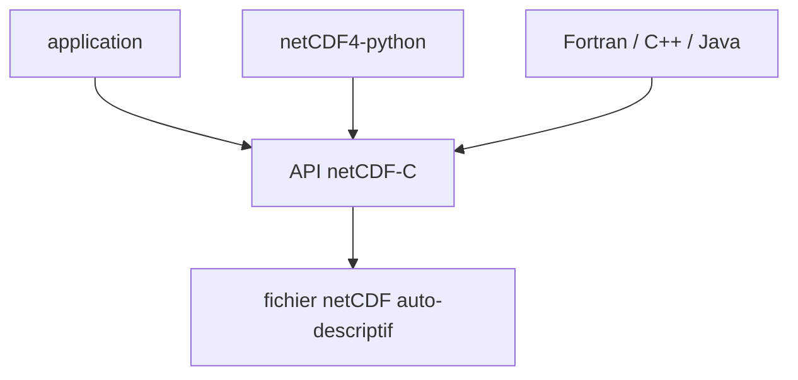

# Unidata/netcdf-c

> Bibliothèque C et format netCDF pour stocker et partager des données scientifiques multidimensionnelles.

## Le problème
Les données scientifiques circulent dans des formats propres à chaque application, non portables entre machines.

## Ce que ça fait vraiment
Fournit une interface et un format de fichier auto-descriptif, portable, à accès direct (lecture d'un sous-ensemble sans tout lire) et extensible (ajout sans recopie). Cette distribution est en C ; Java, Fortran, Python et C++ sont des distributions séparées d'Unidata. L'installation passe par CMake ou Autoconf.

## Comment c'est branché
Schéma simplifié d'après la fiche, sans diagramme fourni.

## Essayer
Le README ne donne pas de commande : il renvoie au fichier INSTALL et aux guides CMake et Autoconf.

## Coût et pièges
Gratuit, licence BSD-3-Clause. Compilation en C ; 293 issues ouvertes. Le README ne détaille pas l'usage.

## Ce que ce n'est pas
Ce n'est pas une base de données ni un outil de visualisation : c'est une couche d'accès aux fichiers.

## Alternatives
Aucune alternative nommée dans le README.

## Pour toi
À adopter si tu manipules des données climatiques ou géophysiques multidimensionnelles : c'est la brique de référence derrière netCDF4-python.

