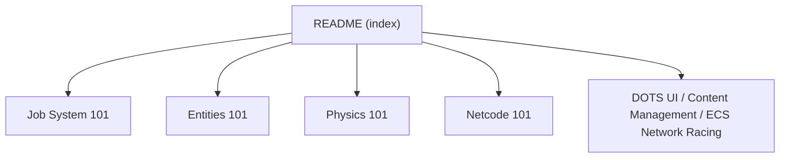

# Unity-Technologies/EntityComponentSystemSamples

> Official Unity sample projects for learning DOTS: Entities, Physics, Netcode, Graphics.

## The problem
Learning Unity's ECS/DOTS architecture without reference examples is difficult.

## What it actually does
A repo of small sample projects (Entities, Physics, Netcode, Entities.Graphics HDRP and URP) for Unity 6.2 with 1.4 packages. The README serves as an index: "101" tracks (Job System, Entities, Physics, Netcode), videos, cheat sheets and manuals.

## How it is wired

Simplified diagram: the README provides no diagram.

## Trying it
No command documented in the README: open the sample projects in Unity 6.2.

## Cost and gotchas
Free, but you need the Unity 6.2 editor and its 1.4 packages. The README does not detail the installation.

## What it is not
Not a library to install or a complete game. License present but not identified by GitHub.

## Alternatives
No alternative named in the README.

## For you
Ignore: Unity game development examples with no direct relation to data, AI or MLOps.
