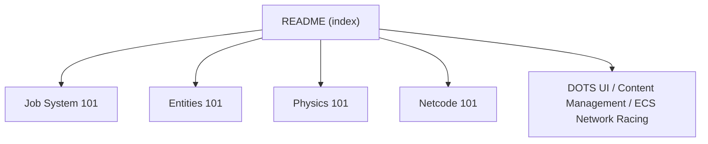

# Unity-Technologies/EntityComponentSystemSamples

> Projets d'exemple officiels Unity pour apprendre DOTS : Entities, Physics, Netcode, Graphics.

## Le problème
Apprendre l'architecture ECS/DOTS de Unity sans exemples de référence est difficile.

## Ce que ça fait vraiment
Dépôt de petits projets d'exemple (Entities, Physics, Netcode, Entities.Graphics HDRP et URP) pour Unity 6.2 avec les paquets 1.4. Le README sert d'index : parcours « 101 » (Job System, Entities, Physics, Netcode), vidéos, cheat sheets et manuels.

## Comment c'est branché

Schéma simplifié : le README ne fournit pas de diagramme.

## Essayer
Aucune commande documentée dans le README : ouvrir les projets d'exemple dans Unity 6.2.

## Coût et pièges
Gratuit, mais il faut l'éditeur Unity 6.2 et ses paquets 1.4. Le README ne détaille pas l'installation.

## Ce que ce n'est pas
Pas une bibliothèque à installer ni un jeu complet. Licence présente mais non identifiée par GitHub.

## Alternatives
Aucune alternative nommée dans le README.

## Pour toi
À ignorer : exemples de développement de jeu Unity sans rapport direct avec la data, l'IA ou le MLOps.

