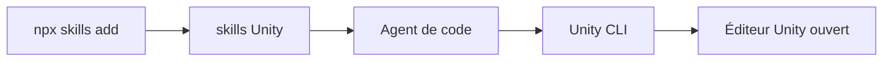

# Unity-Technologies/skills

> Official Unity agent skills for driving the editor, builds and installations.

## The problem
A coding agent knows Unity workflows poorly: in-app purchases, pixel art, tile palettes, editor installation.

## What it actually does
A collection of skills installable with `npx skills add`, compatible with Claude Code, Copilot, Cursor, Cline and more than 50 agents. Many go through the Unity CLI to act on the open editor, install editors, create projects and run builds and tests. For Claude Code or Codex, an official Unity plugin bundles the same skills.

## How it is wired


## Trying it
```bash
npx skills add Unity-Technologies/skills
```

## Cost and gotchas
Free. Many skills assume the Unity CLI (installable by the agent or through the Hub). A license is present but not identified by GitHub.

## What it is not
It is not a game plugin: it is instructions for agents. The exact list of skills is not detailed in the README.

## Alternatives
No named alternative (points to the official Unity plugin).

## For you
Watch: of no interest outside Unity, but an official source, so safer than community skills in the same domain.
