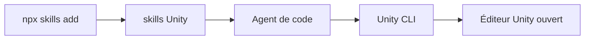

# Unity-Technologies/skills

> Skills d'agent officiels d'Unity pour piloter l'éditeur, les builds et les installations.

## Le problème
Un agent de code connaît mal les flux Unity : achats intégrés, pixel art, palettes de tuiles, installation d'éditeur.

## Ce que ça fait vraiment
Une collection de skills installable avec `npx skills add`, compatible avec Claude Code, Copilot, Cursor, Cline et plus de 50 agents. Beaucoup passent par la CLI Unity pour agir sur l'éditeur ouvert, installer des éditeurs, créer des projets et lancer builds et tests. Pour Claude Code ou Codex, un plugin Unity officiel regroupe les mêmes skills.

## Comment c'est branché


## Essayer
```bash
npx skills add Unity-Technologies/skills
```

## Coût et pièges
Gratuit. Beaucoup de skills supposent la CLI Unity (installable par l'agent ou par le Hub). Licence présente mais non identifiée par GitHub.

## Ce que ce n'est pas
Ce n'est pas un plugin de jeu : ce sont des consignes pour agents. La liste exacte des skills n'est pas détaillée dans le README.

## Alternatives
Aucune alternative nommée (renvoie vers le plugin Unity officiel).

## Pour toi
À surveiller : sans intérêt hors Unity, mais source officielle, donc plus sûre que les skills communautaires du même domaine.

