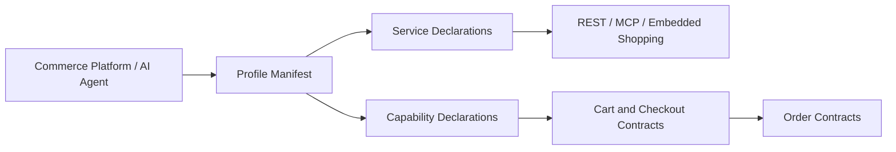

# Universal-Commerce-Protocol/ucp

> Open commerce standard between AI agents, merchants and payment providers, for agent designers.

## The problem
Each platform integrates each merchant by hand, which blocks purchases made by agents.

## What it actually does
It is a specifications repository, not a merchant backend. It provides JSON schemas (profile, capabilities, checkout, order, payment tokens), REST, MCP and embedded contracts, and MkDocs documentation. A profile published by the merchant lets agents discover its capabilities. A tool validates the examples against the schemas.

## How it is wired


## Trying it
```bash
cargo install ucp-schema
ucp-schema lint source/
uv sync
uv run mkdocs serve --watch source
```

## Cost and gotchas
Free. The tools require Rust (`cargo`) and `uv`. About 199 open issues: the standard is moving.

## What it is not
Not a shop implementation nor a complete SDK. No evidence in the sampled sources of a merchant server or of a verified call order.

## Alternatives
No alternative named in the README.

## For you
Worth watching if you build agents that buy: the protocol may become the standard, but it is very young (created late 2025).
