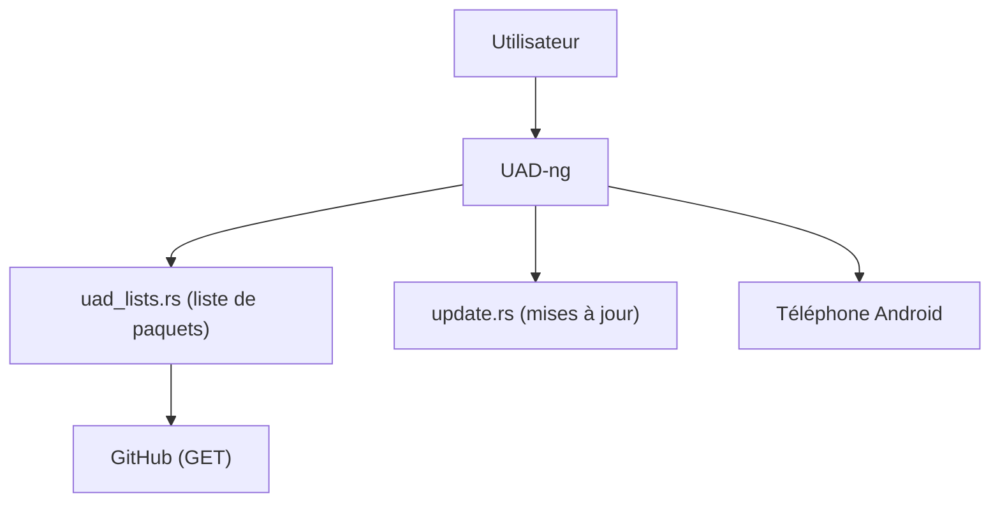

# Universal-Debloater-Alliance/universal-android-debloater-next-generation

> Desktop application that removes unnecessary system apps from an Android phone.

## The problem
Manufacturers preinstall opaque apps that consume power, memory and privacy.

## What it actually does
A detached fork of UAD. Lists system packages with removal recommendations. Only external connections according to the README: fetching the package list and checking for updates on GitHub. The usage guide is in the wiki.

## How it is wired
Simplified diagram based on the sheet, no diagram provided.



## Trying it
```bash
# Aucune commande documentée dans le README (voir le wiki).
```

## Cost and gotchas
Free. README warning: use at your own risk, no liability if the device is damaged. 274 open issues.

## What it is not
Not a complete security tool. Removing a system package can impair the device.

## Alternatives
Canta (no PC, via Shizuku), AppManager, De-Bloater (Magisk).

## For you
Ignore: personal phone utility, unrelated to your data / AI / MLOps work.
