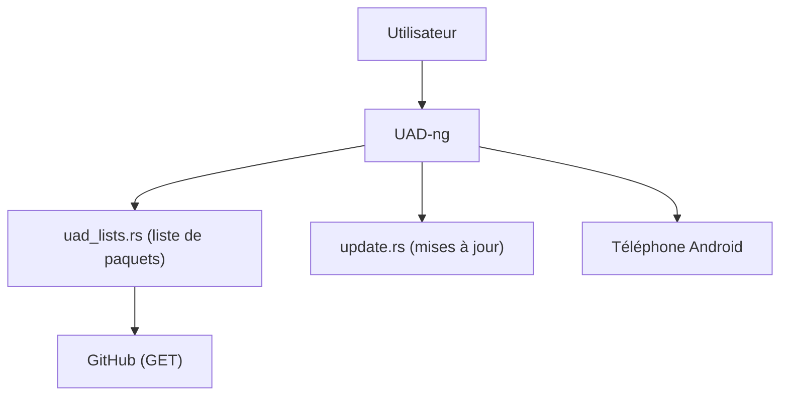

# Universal-Debloater-Alliance/universal-android-debloater-next-generation

> Application de bureau qui supprime les applications système inutiles d'un téléphone Android.

## Le problème
Les constructeurs préinstallent des applications opaques qui consomment énergie, mémoire et vie privée.

## Ce que ça fait vraiment
Fork détaché de UAD. Liste les paquets système avec des recommandations de suppression. Seules connexions externes selon le README : récupération de la liste de paquets et vérification des mises à jour sur GitHub. Le guide d'usage est dans le wiki.

## Comment c'est branché
Schéma simplifié d'après la fiche, sans diagramme fourni.



## Essayer
```bash
# Aucune commande documentée dans le README (voir le wiki).
```

## Coût et pièges
Gratuit. Avertissement du README : usage à tes risques, aucune responsabilité si l'appareil est endommagé. 274 issues ouvertes.

## Ce que ce n'est pas
Pas un outil de sécurité complet. Retirer un paquet système peut gêner l'appareil.

## Alternatives
Canta (sans PC, via Shizuku), AppManager, De-Bloater (Magisk).

## Pour toi
À ignorer : utilitaire personnel pour téléphone, sans lien avec ton travail data / IA / MLOps.

