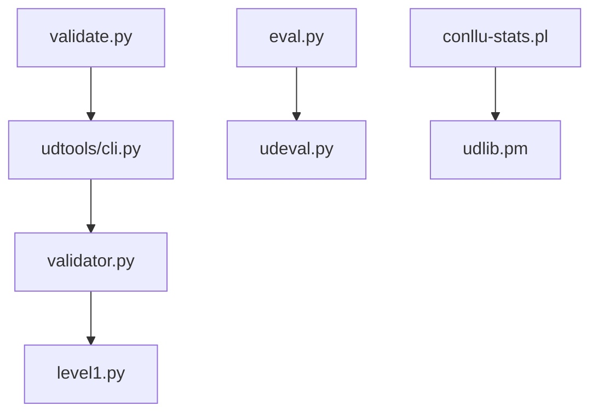

# UniversalDependencies/tools

> Perl and Python scripts to validate, evaluate and transform Universal Dependencies treebanks in CoNLL-U format.

## The problem
Checking the consistency of a CoNLL-U treebank, and finding duplicates and errors before publication, is tedious.

## What it actually does
`validate.py` checks files by level, `eval.py` scores analyses, and many Perl scripts (via `udlib`) handle statistics, Unicode normalization, duplicates, CoNLL-X and plain-text conversions, and token alignment.

## How it is wired


## Trying it
```bash
cat *.conllu | perl check_sentence_ids.pl
perl normalize_unicode.pl < input.conllu > normalized_output.conllu
perl conllu-stats.pl *.conllu > stats.xml
```

## Cost and gotchas
Free. Perl (and cpan for YAML, JSON::Parse, Moose, Lingua::Interset) in addition to Python. GPL-2.0.

## What it is not
Not a parser: it produces no annotations, it checks and converts.

## Alternatives
No alternative named in the README.

## For you
Adopt if you work on annotated NLP corpora: these are the official UD validation tools.
