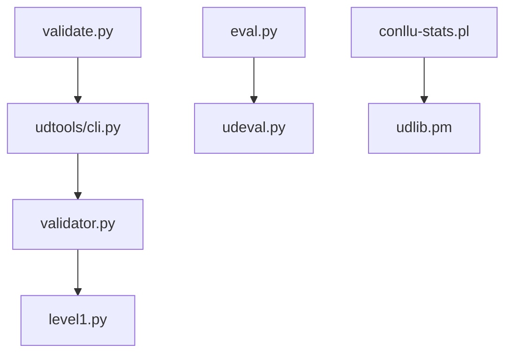

# UniversalDependencies/tools

> Scripts Perl et Python pour valider, évaluer et transformer les treebanks Universal Dependencies au format CoNLL-U.

## Le problème
Vérifier la cohérence d'un treebank CoNLL-U, trouver doublons et erreurs avant publication est fastidieux.

## Ce que ça fait vraiment
`validate.py` contrôle les fichiers par niveau, `eval.py` note les analyses, et de nombreux scripts Perl (via `udlib`) font statistiques, normalisation Unicode, doublons, conversions CoNLL-X et texte brut, alignement de tokens.

## Comment c'est branché


## Essayer
```bash
cat *.conllu | perl check_sentence_ids.pl
perl normalize_unicode.pl < input.conllu > normalized_output.conllu
perl conllu-stats.pl *.conllu > stats.xml
```

## Coût et pièges
Gratuit. Perl (et cpan pour YAML, JSON::Parse, Moose, Lingua::Interset) en plus de Python. GPL-2.0.

## Ce que ce n'est pas
Pas un analyseur syntaxique : il ne produit pas d'annotations, il contrôle et convertit.

## Alternatives
Aucune alternative nommée dans le README.

## Pour toi
À adopter si tu travailles sur des corpus NLP annotés : ce sont les outils officiels de validation UD.

