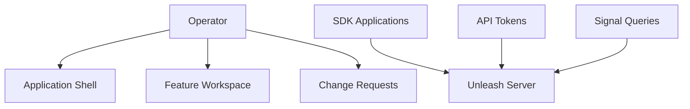

# Unleash/unleash

> Feature flag management server, with SDKs and a web console, self-hostable.

## The problem
Deploy code in small releases and enable features per user without redeploying.

## What it actually does
Web console to create flags, activation strategies, progressive rollouts, kill switches, A/B tests, API tokens and service accounts. Applications query the server through 15 official SDKs. Advanced features (RBAC, SSO, SCIM, change requests) belong to the Pro and Enterprise plans.

## How it is wired


## Trying it
```bash
git clone git@github.com:Unleash/unleash.git
cd unleash
docker compose up -d
# http://localhost:4242, admin / unleash4all
```

## Cost and gotchas
Free open source, but key features are paid. The default credentials (`admin` / `unleash4all`) must be changed. AGPL license.

## What it is not
Not an ML experimentation tool: A/B tests are done in code. The server code is not detailed in the sampled architecture.

## Alternatives
No alternative named in the README.

## For you
Worth watching: useful for progressively enabling a model or AI feature, but only if you already have services to manage.
