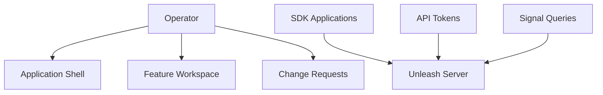

# Unleash/unleash

> Serveur de gestion de feature flags, avec SDK et console web, auto-hébergeable.

## Le problème
Déployer du code en petites versions et activer les fonctions par utilisateur sans redéployer.

## Ce que ça fait vraiment
Console web pour créer des flags, stratégies d'activation, déploiements progressifs, interrupteurs d'urgence, tests A/B, jetons d'API et comptes de service. Les applications interrogent le serveur via 15 SDK officiels. Les fonctions avancées (RBAC, SSO, SCIM, demandes de changement) relèvent des offres Pro et Enterprise.

## Comment c'est branché


## Essayer
```bash
git clone git@github.com:Unleash/unleash.git
cd unleash
docker compose up -d
# http://localhost:4242, admin / unleash4all
```

## Coût et pièges
Open source gratuit, mais des fonctions clés sont payantes. Les identifiants par défaut (`admin` / `unleash4all`) sont à changer. Licence AGPL.

## Ce que ce n'est pas
N'est pas un outil d'expérimentation ML : les tests A/B sont côté code. Le code serveur n'est pas détaillé dans l'architecture échantillonnée.

## Alternatives
Aucune alternative nommée dans le README.

## Pour toi
À surveiller : utile pour activer progressivement un modèle ou une fonction IA, mais seulement si tu as déjà des services à piloter.

