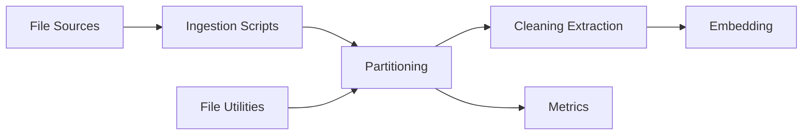

# Unstructured-IO/unstructured

> Python library that splits PDF, HTML, Word and images into structured elements for LLM pipelines.

## The problem
Heterogeneous documents (PDF, e-mails, Office) must be cleaned and segmented before feeding a RAG or an LLM.

## What it actually does
`partition()` detects the file type and routes to a dedicated partitioner, which returns a list of typed elements. On top come cleaners, file utilities, metrics, embedding integrations and ingestion connectors. OCR and conversions go through tesseract, poppler, libreoffice.

## How it is wired


## Trying it
```bash
pip install "unstructured[all-docs]"
docker pull downloads.unstructured.io/unstructured-io/unstructured:latest
```
```python
from unstructured.partition.auto import partition
elements = partition("example-docs/layout-parser-paper.pdf")
```

## Cost and gotchas
Free library, but with system dependencies (libmagic, poppler, tesseract, libreoffice). Telemetry is sent by default: disable it with `DO_NOT_TRACK` or `SCARF_NO_ANALYTICS`. Best quality comes through the paid Transform API.

## What it is not
The open source version is clearly less accurate on tables than the commercial API (README figures: 0.426 versus 0.866 on cell content).

## Alternatives
No alternative named in the README.

## For you
Adopt for a RAG pipeline: de facto standard, Apache-2.0; turn off telemetry and test accuracy on your own PDFs.
