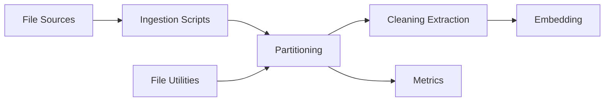

# Unstructured-IO/unstructured

> Bibliothèque Python qui découpe PDF, HTML, Word et images en éléments structurés pour des pipelines LLM.

## Le problème
Les documents hétérogènes (PDF, e-mails, Office) doivent être nettoyés et segmentés avant d'alimenter un RAG ou un LLM.

## Ce que ça fait vraiment
`partition()` détecte le type de fichier et route vers un partitionneur dédié, qui renvoie une liste d'éléments typés. S'y ajoutent nettoyeurs, utilitaires de fichiers, métriques, intégrations d'embeddings et connecteurs d'ingestion. OCR et conversions passent par tesseract, poppler, libreoffice.

## Comment c'est branché


## Essayer
```bash
pip install "unstructured[all-docs]"
docker pull downloads.unstructured.io/unstructured-io/unstructured:latest
```
```python
from unstructured.partition.auto import partition
elements = partition("example-docs/layout-parser-paper.pdf")
```

## Coût et pièges
Bibliothèque gratuite, mais dépendances système (libmagic, poppler, tesseract, libreoffice). Télémétrie envoyée par défaut : à désactiver avec `DO_NOT_TRACK` ou `SCARF_NO_ANALYTICS`. Meilleure qualité via l'API payante Transform.

## Ce que ce n'est pas
La version open source est nettement moins précise sur les tables que l'API commerciale (chiffres du README : 0,426 contre 0,866 sur le contenu des cellules).

## Alternatives
Aucune alternative nommée dans le README.

## Pour toi
Adopter pour un pipeline RAG : standard de fait, Apache-2.0 ; couper la télémétrie et tester la précision sur tes propres PDF.

