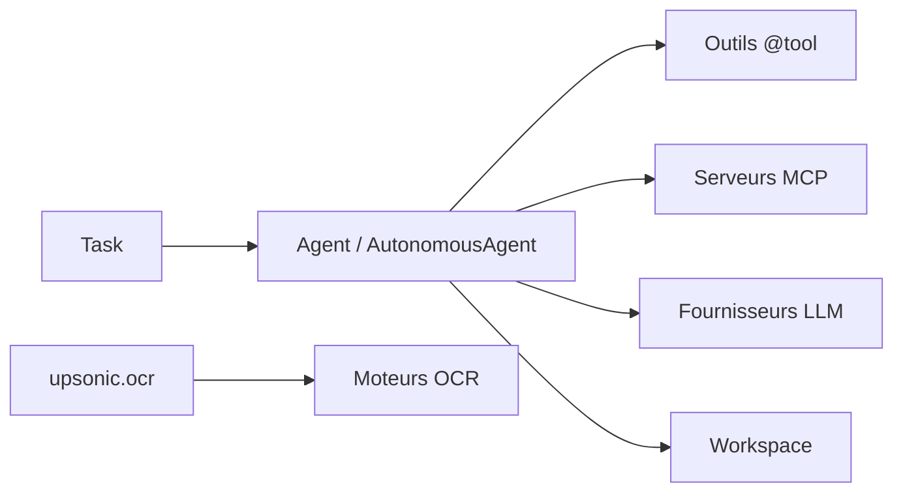

# Upsonic/Upsonic

> Python framework for building LLM agents, autonomous or classic, with tools and OCR.

## The problem
Assembling an agent with tools, a secure workspace and OCR takes a lot of plumbing.

## What it actually does
`AutonomousAgent` confines file and shell operations to a `workspace` and blocks path traversal.
`Agent` and `Task` for classic agents, `@tool` for custom tools, MCP support.
A layered OCR module with several engines (EasyOCR, RapidOCR, Tesseract, PaddleOCR, DeepSeek OCR).
Community prebuilt agents; optional E2B sandbox.

## How it is wired


## Trying it
```bash
uv pip install upsonic
uv pip install "upsonic[ocr]"
```

## Cost and gotchas
LLM provider key at your expense (Anthropic in the examples). The architecture mentions anonymous usage telemetry.

## What it is not
Not a finished product: it is a framework. The described architecture (servers, reliability) seems to match an older version and does not line up with the README.

## Alternatives
No alternative named in the README.

## For you
Worth watching: the API is simple and the built-in OCR is a plus, but nothing in the README clearly sets it apart from established agent frameworks.
