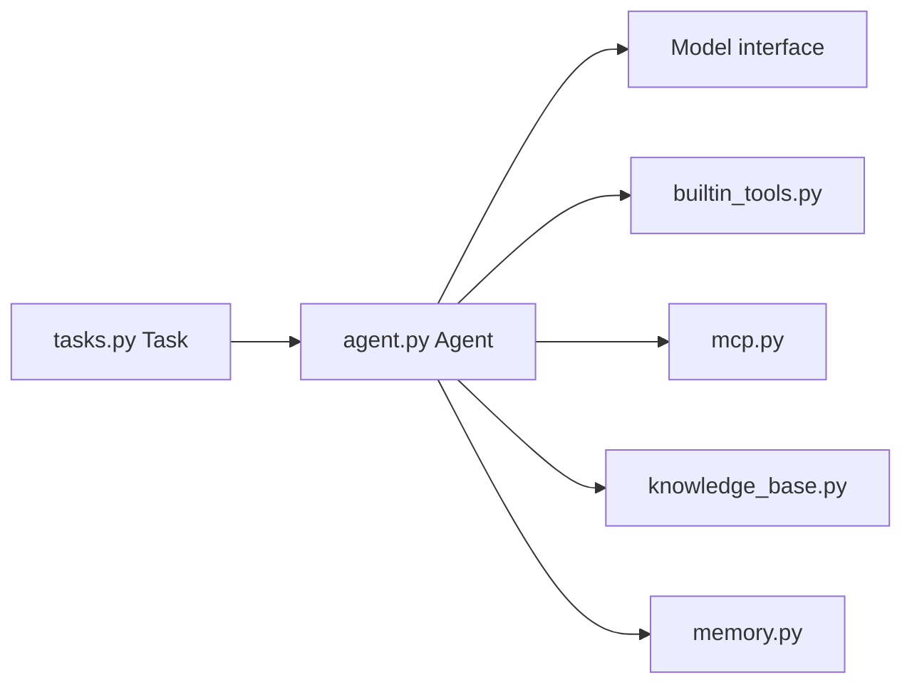

# Upsonic/gpt-computer-assistant

> Python framework for building autonomous or classic AI agents with tools, memory and OCR.

## The problem
Assembling an agent (model, tools, memory, documents) takes a lot of glue code.

## What it actually does
A `Task` is submitted to an `Agent` or an `AutonomousAgent`, which calls the chosen model and tools (`@tool`, MCP). The autonomous agent restricts files and shell to a `workspace` and blocks dangerous commands. The repository also contains agent teams, knowledge base, memory, workflow graphs, usage tracking and a two-layer OCR pipeline (EasyOCR, RapidOCR, Tesseract, PaddleOCR, DeepSeek OCR).

## How it is wired


## Trying it
```bash
uv pip install upsonic
```
```python
from upsonic import Agent, Task
agent = Agent(model="anthropic/claude-sonnet-4-5", name="Stock Analyst Agent")
task = Task(description="Analyze the current market trends")
agent.print_do(task)
```

## Cost and gotchas
Model provider API key at your expense. OCR is optional via `upsonic[ocr]`. Cloud isolation with E2B is offered as a next step.

## What it is not
It is no longer the computer assistant suggested by the repository name: the README presents Upsonic, an agent framework.

## Alternatives
Not documented: the README names no alternative.

## For you
Keep an eye on it: a reasonable MIT option for prototyping Python agents, but with no documented comparison against other frameworks.
