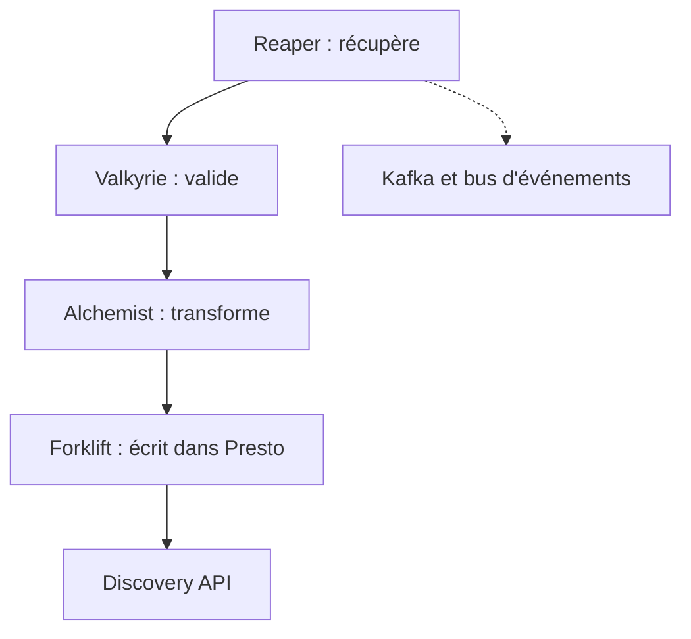

# UrbanOS-Public/smartcitiesdata

> Smart-city data platform made of Elixir microservices built around Kafka and Presto.

## The problem
Ingesting, normalising and exposing data from very different sources requires a whole pipeline to be assembled.

## What it actually does
Elixir microservices ingest, validate, transform, persist and distribute the data. The services communicate through Kafka and an event bus, store on S3-compatible object storage and query through PrestoDB. Access goes through a ReactJS interface, a REST API or a websocket API. Andi, Reaper, Valkyrie, Alchemist, Forklift and Discovery are the services.

## How it is wired


## Trying it
```bash
docker build .
mix test
mix test.integration
mix test.e2e
```

## Cost and gotchas
Deployment assumes Kubernetes, Kafka, Redis, Elasticsearch, PostgreSQL, Presto and Vault: heavy infrastructure. The README is a template, and several sections (Execution, Additional Notes, Contributions) are empty.

## What it is not
It is not an application to install with a single command. The execution section is empty in the README, so you have to go through the wiki.

## Alternatives
- No alternative named in the README.

## For you
Worth watching: interesting as a reference architecture for open-data ingestion, too heavy to deploy for a quick trial.
