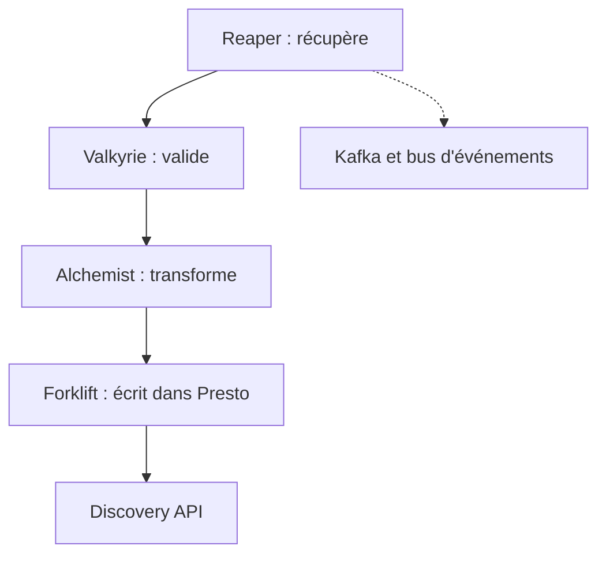

# UrbanOS-Public/smartcitiesdata

> Plateforme de données de villes intelligentes en micro-services Elixir autour de Kafka et Presto.

## Le problème
Ingérer, normaliser et exposer des données de sources très différentes demande tout un pipeline à assembler.

## Ce que ça fait vraiment
Des micro-services Elixir ingèrent, valident, transforment, persistent et diffusent les données. Les services échangent via Kafka et un bus d'événements, stockent sur du stockage objet compatible S3 et interrogent via PrestoDB. L'accès passe par une interface ReactJS, une API REST ou une API websocket. Andi, Reaper, Valkyrie, Alchemist, Forklift et Discovery sont les services.

## Comment c'est branché


## Essayer
```bash
docker build .
mix test
mix test.integration
mix test.e2e
```

## Coût et pièges
Le déploiement suppose Kubernetes, Kafka, Redis, Elasticsearch, PostgreSQL, Presto et Vault : une infrastructure lourde. Le README est un gabarit, plusieurs sections (Execution, Additional Notes, Contributions) sont vides.

## Ce que ce n'est pas
Ce n'est pas une application à installer en une commande. La section d'exécution est vide dans le README, il faut passer par le wiki.

## Alternatives
- Aucune alternative nommée dans le README.

## Pour toi
À surveiller : intéressant comme architecture de référence d'ingestion de données ouvertes, trop lourd à déployer pour un essai rapide.

