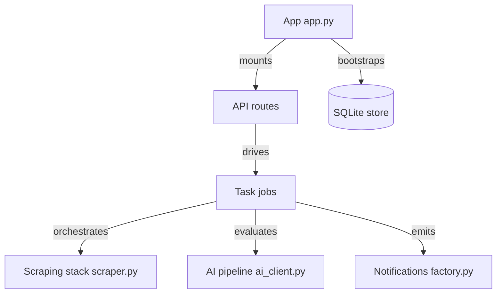

# Usagi-org/ai-goofish-monitor

> Monitors Xianyu (Goofish) by keywords and multimodal AI, with a web interface and notifications.

## The problem
Manually tracking new listings on a Chinese second-hand marketplace and judging whether they are worth it.

## What it actually does
- Scheduled search tasks (Cron) with their own price, region, filters and AI prompt.
- Playwright/Chromium scans the listings, downloads the images, an OpenAI-compatible model analyzes them.
- Notifies via ntfy, Gotify, Bark, Telegram, WeCom or webhook; account and proxy rotation.
- SQLite storage, Vue 3 interface on a FastAPI backend.

## How it is wired


## Trying it
```bash
git clone https://github.com/Usagi-org/ai-goofish-monitor && cd ai-goofish-monitor
cp .env.example .env
docker compose up -d
docker compose logs -f app
```

## Cost and gotchas
You need `OPENAI_API_KEY`, `OPENAI_BASE_URL` and a model that accepts images: the bill is on you. A Xianyu account and the export of its login state (Chrome extension) are required. Default web credentials `admin/admin123`.

## What it is not
Not a general monitoring tool. Depends on the Xianyu site: risk of account blocking and of breakage when pages change. The README reminds you to respect the site's terms.

## Alternatives
- superboyyy/xianyu_spider: the project it is inspired by.

## For you
Ignore: very specific use case on a Chinese marketplace, unrelated to a data/AI/MLOps profile, except as an example of a scraping plus LLM pipeline.
