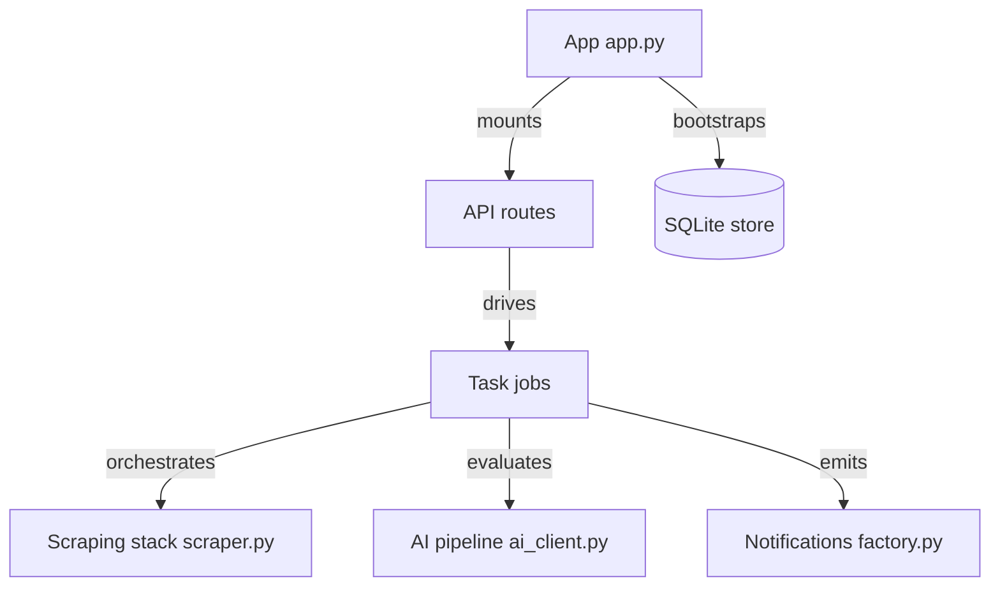

# Usagi-org/ai-goofish-monitor

> Surveille Xianyu (Goofish) par mots-clés et IA multimodale, avec interface web et notifications.

## Le problème
Suivre à la main les nouvelles annonces d'une place de marché d'occasion chinoise et juger si elles valent le coup.

## Ce que ça fait vraiment
- Tâches de recherche planifiées (Cron) avec prix, région, filtres et prompt IA propres.
- Playwright/Chromium scrute les annonces, télécharge les images, un modèle compatible OpenAI les analyse.
- Notifie via ntfy, Gotify, Bark, Telegram, WeCom ou webhook ; rotation de comptes et de proxys.
- Stockage SQLite, interface Vue 3 sur backend FastAPI.

## Comment c'est branché


## Essayer
```bash
git clone https://github.com/Usagi-org/ai-goofish-monitor && cd ai-goofish-monitor
cp .env.example .env
docker compose up -d
docker compose logs -f app
```

## Coût et pièges
Il faut `OPENAI_API_KEY`, `OPENAI_BASE_URL` et un modèle acceptant les images : facture à ta charge. Un compte Xianyu et l'export de son état de connexion (extension Chrome) sont requis. Identifiants Web par défaut `admin/admin123`.

## Ce que ce n'est pas
Pas un outil général de veille. Dépend du site Xianyu : risque de blocage de compte et de rupture par changement de page. Le README rappelle de respecter les conditions du site.

## Alternatives
- superboyyy/xianyu_spider : projet dont il s'inspire.

## Pour toi
À ignorer : cas d'usage très spécifique à une place de marché chinoise, sans lien avec un profil data/IA/MLOps, hormis comme exemple de pipeline scraping plus LLM.

