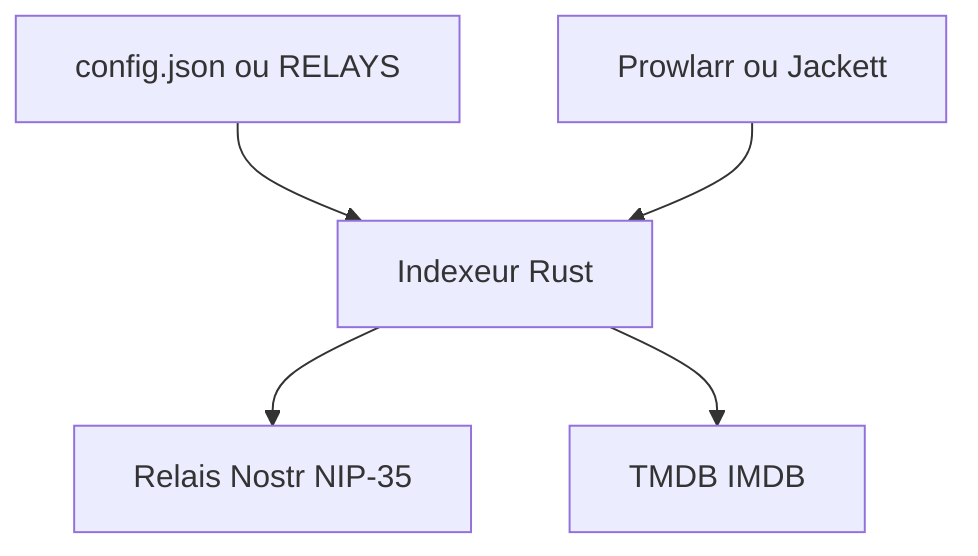

# UwUDev/ygege

> Torrent indexer written in Rust, querying Nostr relays via NIP-35, compatible with Prowlarr and Jackett.

## The problem
Classic torrent indexers rely on site scraping. They depend on accounts and centralized sites.

## What it actually does
Queries Nostr relays that expose NIP-35 torrent events, ranks the relays by latency at startup and offers a flexible search (name, seeds, date). Optional Tor, TMDB/IMDB resolution, integration as a custom indexer in Prowlarr and Jackett. No default relay: you must provide one.

## How it is wired
Simplified diagram based on the sheet, no diagram provided.



## Trying it
```yaml
environment:
  RELAYS: "wss://u2p.anhkagi.net"
```
A `config.json` is generated on first launch and contains the `relays` key.

## Cost and gotchas
Free. With no relay configured, the application stops at startup. Build: Rust 1.85.0+. The README includes a legal warning: using torrents may raise copyright issues.

## What it is not
It is not a download tool. It contains no content and ships no relay. The French README calls the project "Francisca" in several places.

## Alternatives
- Prowlarr: the indexer manager it plugs into.
- Jackett: same role as an indexer proxy.

## For you
Ignore: a torrent indexer outside your data/AI/MLOps scope, with a legal risk depending on usage.
