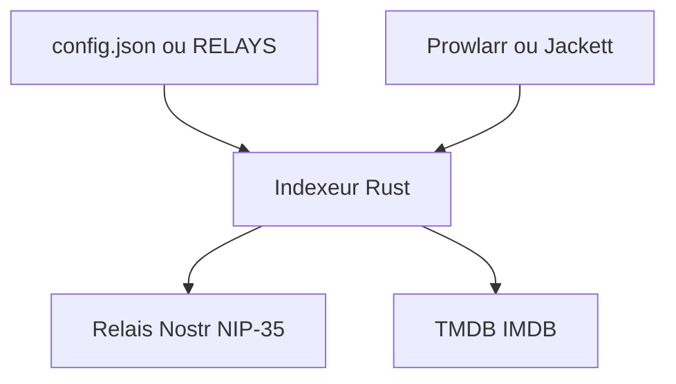

# UwUDev/ygege

> Indexeur de torrents écrit en Rust, interrogeant des relais Nostr via NIP-35, compatible Prowlarr et Jackett.

## Le problème
Les indexeurs de torrents classiques passent par du scraping de sites. Ils dépendent de comptes et de sites centralisés.

## Ce que ça fait vraiment
Interroge des relais Nostr exposant des événements torrent NIP-35, classe les relais par latence au démarrage et propose une recherche modulable (nom, seeds, date). Option Tor, résolution TMDB/IMDB, intégration comme indexeur personnalisé de Prowlarr et Jackett. Aucun relais par défaut : il faut en fournir un.

## Comment c'est branché
Schéma simplifié d'après la fiche, sans diagramme fourni.



## Essayer
```yaml
environment:
  RELAYS: "wss://u2p.anhkagi.net"
```
Un `config.json` est généré au premier lancement et contient la clé `relays`.

## Coût et pièges
Gratuit. Sans relais configuré, l'application s'arrête au démarrage. Compilation : Rust 1.85.0+. Le README comporte un avertissement légal : l'usage de torrents peut poser des problèmes de droit d'auteur.

## Ce que ce n'est pas
Ce n'est pas un outil de téléchargement. Il ne contient aucun contenu ni relais fourni. Le README en français nomme le projet « Francisca » à plusieurs endroits.

## Alternatives
- Prowlarr : gestionnaire d'indexeurs dans lequel il se branche.
- Jackett : même rôle de proxy d'indexeurs.

## Pour toi
À ignorer : indexeur de torrents hors de ton périmètre data/IA/MLOps, avec un risque juridique selon l'usage.

