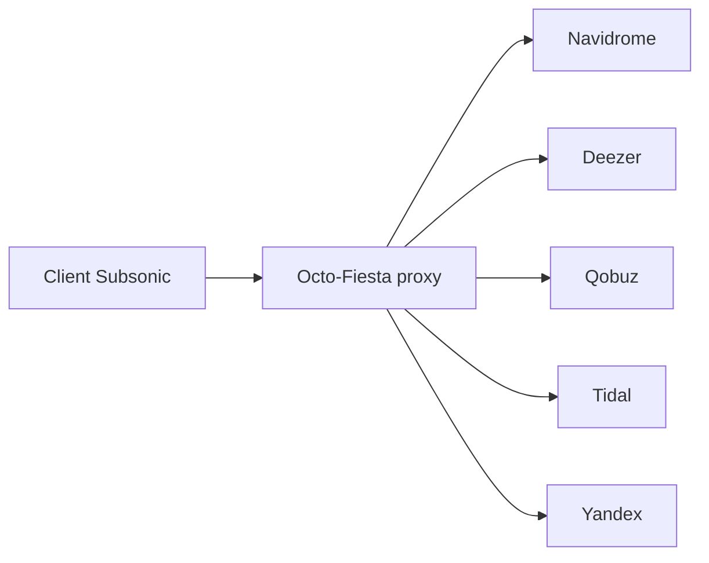

# V1ck3s/octo-fiesta

> Subsonic proxy that complements a Navidrome server with tracks downloaded from Deezer, Qobuz, Tidal or Yandex.

## The problem
When a track is missing from the local Navidrome library, you have to search for it and add it by hand.

## What it actually does
Sits between your Subsonic client and Navidrome. If a track is absent, it searches for it at the configured provider, downloads it (up to 24-bit 192 kHz in FLAC), adds it to the library with tags and cover art, then serves it. Also handles external playlists and synced lyrics via LRCLIB.

## How it is wired


## Trying it
```bash
git clone https://github.com/V1ck3s/octo-fiesta.git
cd octo-fiesta
cp .env.example .env
nano .env
docker-compose up -d
```

## Cost and gotchas
A subscription with the provider and its tokens (Deezer ARL, Qobuz token, Tidal OAuth) are required; they expire and need renewing. Docker or .NET 9.0 SDK required. Check the services' terms of use before downloading.

## What it is not
Not a music player: it is an intermediary for Subsonic clients. Playlists do not always appear in the expected tab depending on the client. SquidWTF is flagged as deprecated.

## Alternatives
No alternative named in the README.

## For you
Ignore: a personal music tool unrelated to data or AI, and dependent on third-party accounts.
