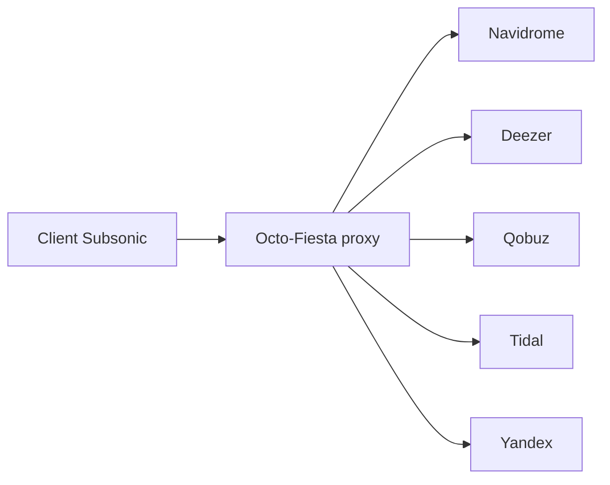

# V1ck3s/octo-fiesta

> Proxy Subsonic qui complète un serveur Navidrome avec des morceaux téléchargés depuis Deezer, Qobuz, Tidal ou Yandex.

## Le problème
Quand un titre manque à la bibliothèque Navidrome locale, il faut le chercher et l'ajouter à la main.

## Ce que ça fait vraiment
S'intercale entre ton client Subsonic et Navidrome. Si un morceau est absent, il le cherche chez le fournisseur configuré, le télécharge (jusqu'à 24 bits 192 kHz en FLAC), l'ajoute à la bibliothèque avec tags et pochette, puis le sert. Gère aussi les playlists externes et les paroles synchronisées via LRCLIB.

## Comment c'est branché


## Essayer
```bash
git clone https://github.com/V1ck3s/octo-fiesta.git
cd octo-fiesta
cp .env.example .env
nano .env
docker-compose up -d
```

## Coût et pièges
Il faut un abonnement chez le fournisseur et ses jetons (ARL Deezer, jeton Qobuz, OAuth Tidal) qui expirent et se renouvellent. Docker ou .NET 9.0 SDK requis. Vérifie les conditions d'usage des services avant de télécharger.

## Ce que ce n'est pas
Pas un lecteur de musique : c'est un intermédiaire pour clients Subsonic. Les playlists n'apparaissent pas toujours dans l'onglet attendu selon le client. SquidWTF est signalé comme déprécié.

## Alternatives
Aucune alternative nommée dans le README.

## Pour toi
À ignorer : outil de musique perso sans lien avec la data ou l'IA, et dépendant de comptes tiers.

