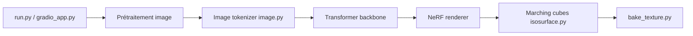

# VAST-AI-Research/TripoSR

> Feed-forward model that reconstructs a 3D object from a single image, for creators and researchers.

## The problem
Getting a 3D mesh from a photo usually requires several views or a long optimization time.

## What it actually does
Inspired by the Large Reconstruction Model: the image is validated, background-removed, tokenized, and passed through a transformer backbone producing "scene codes"; NeRF rendering then mesh extraction by marching cubes, with optional texture baking. The README announces under 0.5 s on an A100; the default option needs about 6 GB of VRAM.

## How it is wired


## Trying it
```bash
pip install --upgrade setuptools
pip install -r requirements.txt
python run.py examples/chair.png --output-dir output/
python gradio_app.py
```

## Cost and gotchas
CUDA GPU recommended, with the machine's CUDA version aligned with PyTorch's. MIT license announced for the code, the models and the demo.

## What it is not
Not a multi-view reconstruction: a single image as input. The result depends on the quality of the background removal.

## Alternatives
No alternative named in the README (which cites a technical comparison report).

## For you
Worth watching: easy to try on a modest GPU for 3D generation, but last commit in June 2026 and no connection to common MLOps pipelines.
