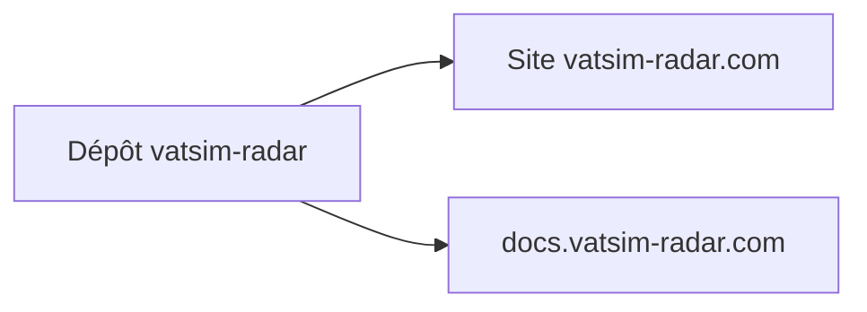

# VATSIM-Radar/vatsim-radar

> Live map website for the VATSIM network, for which the README gives only links.

## The problem
Not documented in the README, which contains only two links.

## What it actually does
Not documented. The README points to the site https://vatsim-radar.com and to the documentation https://docs.vatsim-radar.com. Nothing else is described here.

## How it is wired
Not documented.

Simplified diagram based on the sheet, no diagram provided.

## Trying it
No documented command.

## Cost and gotchas
Not documented. The license is present but not identified by GitHub.

## What it is not
Insufficient material to say more: the README does not reveal what the repository contains, nor how to install it.

## Alternatives
None named in the README.

## For you
Apparently unrelated to data or AI, and the README is empty: ignore.
