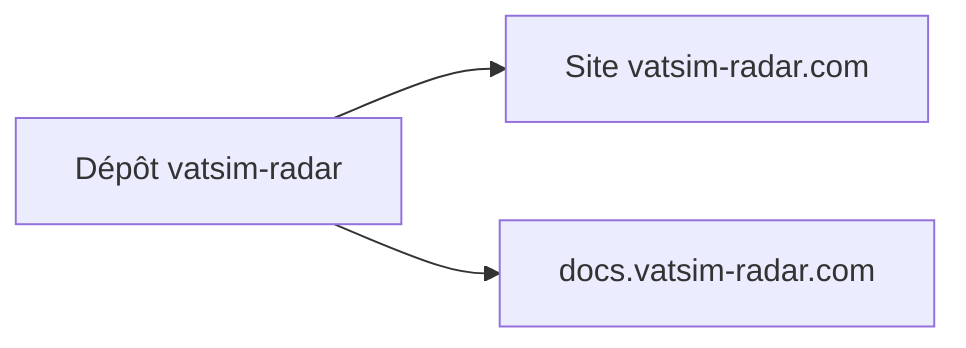

# VATSIM-Radar/vatsim-radar

> Site de carte en direct du réseau VATSIM, dont le README ne donne que les liens.

## Le problème
Non documenté dans le README, qui ne contient que deux liens.

## Ce que ça fait vraiment
Non documenté. Le README renvoie au site https://vatsim-radar.com et à la documentation https://docs.vatsim-radar.com. Rien d'autre n'est décrit ici.

## Comment c'est branché
Non documenté.

Schéma simplifié d'après la fiche, sans diagramme fourni.

## Essayer
Aucune commande documentée.

## Coût et pièges
Non documenté. La licence est présente mais non identifiée par GitHub.

## Ce que ce n'est pas
Matière insuffisante pour dire plus : le README ne permet pas de savoir ce que le dépôt contient, ni comment l'installer.

## Alternatives
Aucune nommée dans le README.

## Pour toi
Sans rapport apparent avec data ou IA, et README vide : à ignorer.

