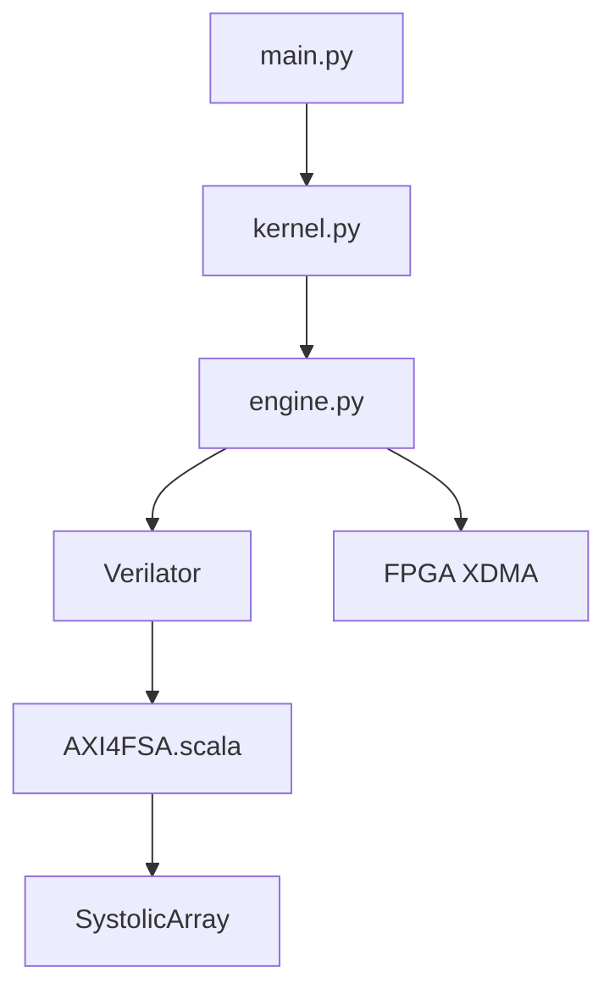

# VCA-EPFL/FSA

> Hardware FlashAttention accelerator in a single systolic array, with Verilator simulation and FPGA.

## The problem
FlashAttention mixes matrix multiplications and vector operations, which requires dedicated units.

## What it actually does
All attention operations run in a systolic array, with no vector unit. A Python API generates the instructions and runs them on Verilator or on an FPGA through XDMA. Precision of about 1e-3 against PyTorch in fp16.

## How it is wired


## Trying it
```bash
git clone git@github.com:VCA-EPFL/chipyard-fsa.git
cd chipyard-fsa
./build-setup.sh --skip-ctags --skip-firesim --skip-marshal
source env.sh
cd sims/verilator && make CONFIG=FSA4X4Fp16Config
cd ../../generators/fsa/python
uv run main.py --seq_q 4 --seq_kv 4 --config FSA4X4Fp16Config
```

## Cost and gotchas
Free, but it needs Chipyard, Conda, Verilator and uv. FPGA: Vivado and a U55C board. No GPU is actually required; "GPU" and RAM are approximations from the list. No license.

## What it is not
Not a software tool for speeding up training: it is a hardware research prototype.

## Alternatives
No alternative named in the README.

## For you
Worth watching: research on attention acceleration, useful for hardware culture, not for everyday MLOps use.
