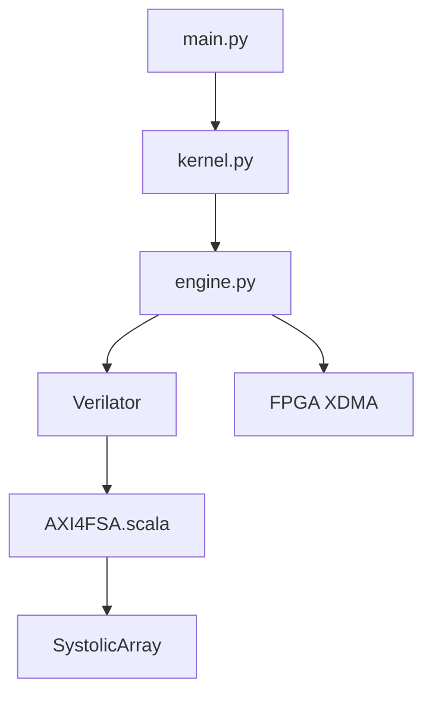

# VCA-EPFL/FSA

> Accélérateur matériel FlashAttention dans un seul réseau systolique, avec simulation Verilator et FPGA.

## Le problème
FlashAttention mélange multiplications matricielles et opérations vectorielles, ce qui impose des unités dédiées.

## Ce que ça fait vraiment
Toutes les opérations d'attention s'exécutent dans un tableau systolique, sans unité vectorielle. Une API Python génère les instructions et les exécute sur Verilator ou un FPGA via XDMA. Précision d'environ 1e-3 contre PyTorch en fp16.

## Comment c'est branché


## Essayer
```bash
git clone git@github.com:VCA-EPFL/chipyard-fsa.git
cd chipyard-fsa
./build-setup.sh --skip-ctags --skip-firesim --skip-marshal
source env.sh
cd sims/verilator && make CONFIG=FSA4X4Fp16Config
cd ../../generators/fsa/python
uv run main.py --seq_q 4 --seq_kv 4 --config FSA4X4Fp16Config
```

## Coût et pièges
Gratuit, mais Chipyard, Conda, Verilator et uv. FPGA : Vivado et carte U55C. Aucun GPU requis en réalité ; « GPU » et RAM sont des approximations de la liste. Aucune licence.

## Ce que ce n'est pas
Pas un outil logiciel pour accélérer l'entraînement : c'est un prototype matériel de recherche.

## Alternatives
Aucune alternative nommée dans le README.

## Pour toi
À surveiller : recherche sur l'accélération d'attention, utile pour la culture matérielle, pas pour un usage MLOps courant.

