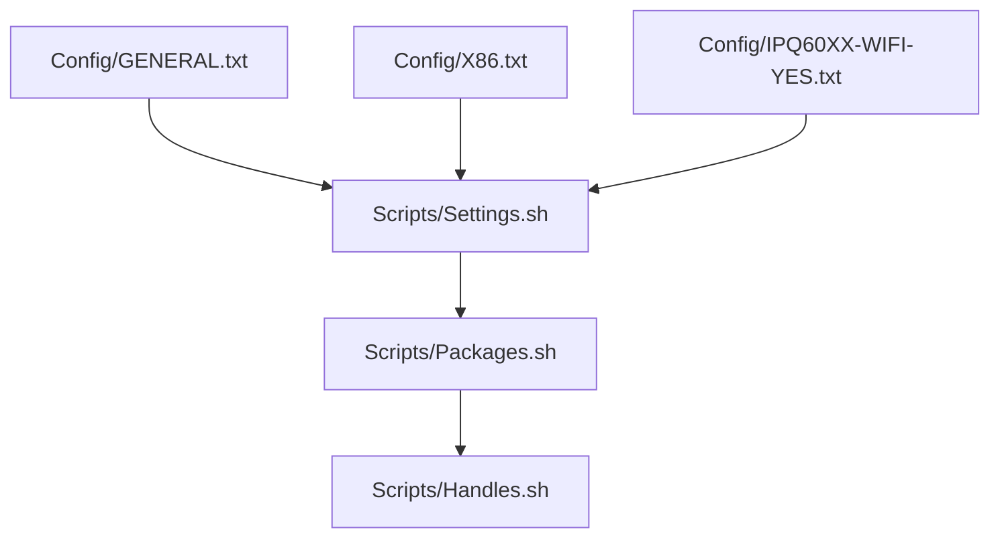

# VIKINGYFY/OpenWRT-CI

> Continuous integration that builds OpenWrt firmware daily for MediaTek, Qualcomm, Rockchip and x86 routers.

## The problem
Getting an up-to-date OpenWrt firmware for a specific router means rebuilding the compilation toolchain yourself.

## What it actually does
The workflows launch an ImmortalWrt build every day at 5 a.m. One file per target in Config/, completed by GENERAL.txt, defines the firmware. The Settings.sh, Packages.sh and Handles.sh scripts apply settings, add packages and patch the sources. The README is in Chinese and points to companion repositories (U-Boot, packages).

## How it is wired

## Trying it
No command documented in the README. The workflows are in workflows/ and the local builder is in the VIKINGYFY/OWRT-Tools repository.

## Cost and gotchas
Free, but the build runs on GitHub Actions. The images are unofficial: flashing them onto a router carries a risk of bricking it.

## What it is not
Not an official OpenWrt firmware. No English documentation.

## Alternatives
Official ImmortalWrt, named in the README, if you want the reference source.

## For you
Ignore: this is router tinkering, unrelated to data / AI / MLOps work.
