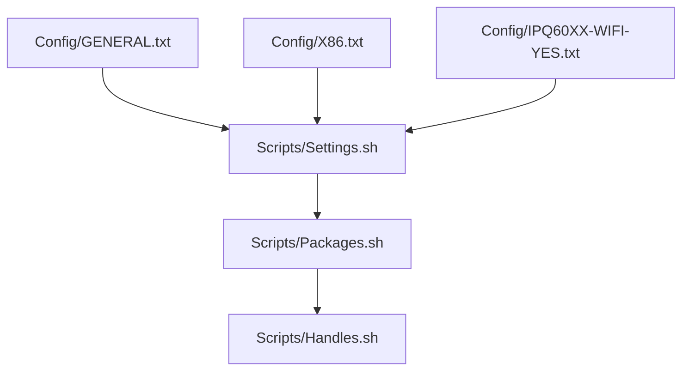

# VIKINGYFY/OpenWRT-CI

> Intégration continue qui compile chaque jour des micrologiciels OpenWrt pour routeurs MediaTek, Qualcomm, Rockchip et x86.

## Le problème
Obtenir un firmware OpenWrt à jour pour un routeur précis demande de reconstruire soi-même la chaîne de compilation.

## Ce que ça fait vraiment
Les workflows lancent chaque jour à 5 h une compilation d'ImmortalWrt. Un fichier par cible dans Config/, complété par GENERAL.txt, définit le firmware. Les scripts Settings.sh, Packages.sh et Handles.sh appliquent les réglages, ajoutent les paquets et corrigent les sources. Le README est en chinois et renvoie vers des dépôts annexes (U-Boot, paquets).

## Comment c'est branché

## Essayer
Aucune commande documentée dans le README. Les workflows sont dans workflows/ et le compilateur local dans le dépôt VIKINGYFY/OWRT-Tools.

## Coût et pièges
Gratuit, mais la compilation tourne sur GitHub Actions. Les images sont non officielles : les flasher sur un routeur comporte un risque de blocage.

## Ce que ce n'est pas
Pas un firmware officiel OpenWrt. Pas de documentation en anglais.

## Alternatives
ImmortalWrt officiel, nommé dans le README, si tu veux la source de référence.

## Pour toi
Ignorer : c'est du bricolage de routeurs, sans lien avec un travail data / IA / MLOps.

