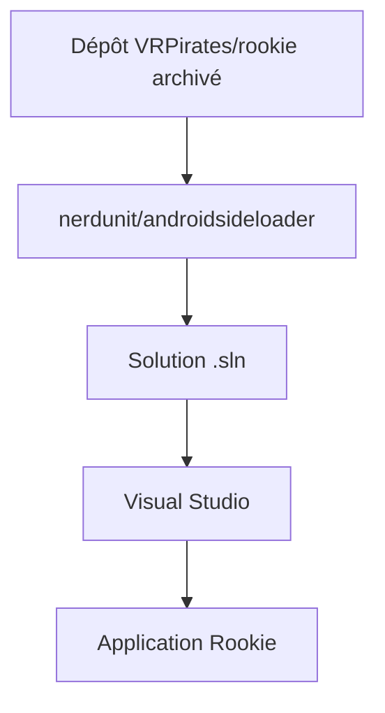

# VRPirates/rookie

> Windows application for sideloading Android apps, repository moved to nerdunit/androidsideloader.

## The problem
Manually installing applications on an Android device (VR headset) without going through the official store.

## What it actually does
The README does not describe the features: it announces that the repository has moved, warns of a risk of antivirus false positives and gives build instructions. WinForms application in C#.

## How it is wired
Simplified diagram based on the card, no diagram provided.



## Trying it
```bash
# Aucune commande : build via Visual Studio (ouvrir le .sln, Build > Build Solution, Ctrl+Shift+B)
```

## Cost and gotchas
Windows and Visual Studio required, .NET Framework 4.5.2. Rookie must run in a dedicated folder (C:\RSL\Rookie): it cleans its own folder and may delete files there.

## What it is not
Not the repository to follow: it is archived and points to the original repository. Not a cross-platform tool.

## Alternatives
- nerdunit/androidsideloader: the project's new home, the only one maintained.

## For you
Ignore: archived and unrelated to a data / AI / MLOps profile; if needed, look at the original repository.
