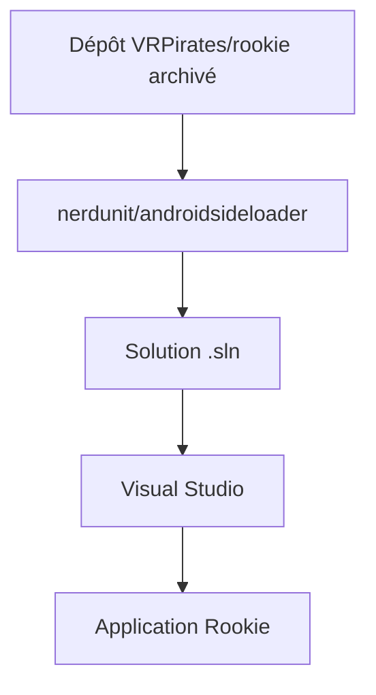

# VRPirates/rookie

> Application Windows de sideloading d'applications Android, dépôt déplacé vers nerdunit/androidsideloader.

## Le problème
Installer à la main des applications sur un appareil Android (casque VR) sans passer par la boutique officielle.

## Ce que ça fait vraiment
Le README ne décrit pas les fonctions : il annonce que le dépôt est déplacé, signale un risque de faux positif antivirus et donne les instructions de compilation. Application WinForms en C#.

## Comment c'est branché
Schéma simplifié d'après la fiche, sans diagramme fourni.



## Essayer
```bash
# Aucune commande : build via Visual Studio (ouvrir le .sln, Build > Build Solution, Ctrl+Shift+B)
```

## Coût et pièges
Windows et Visual Studio requis, .NET Framework 4.5.2. Rookie doit tourner dans un dossier dédié (C:\RSL\Rookie) : il nettoie son propre dossier et peut y effacer des fichiers.

## Ce que ce n'est pas
Pas le dépôt à suivre : il est archivé et renvoie vers le dépôt d'origine. Pas un outil multiplateforme.

## Alternatives
- nerdunit/androidsideloader : nouveau foyer du projet, seul maintenu.

## Pour toi
Ignorer : archivé et sans rapport avec un profil data / IA / MLOps ; si besoin, regarder le dépôt d'origine.

