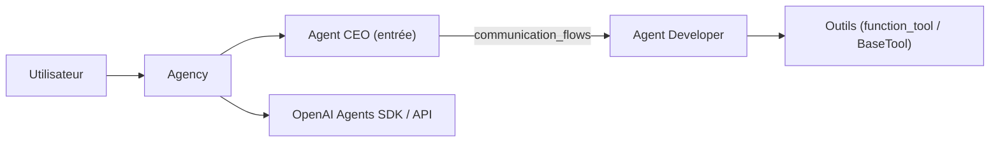

# VRSEN/agency-swarm

> Python framework for orchestrating teams of AI agents, built on the OpenAI Agents SDK.

## The problem
Coordinating several agents with distinct roles, with clear rules about who can talk to whom.

## What it actually does
You define agents (role, instructions, Pydantic tools or `@function_tool`) and an `Agency` with directional `communication_flows` (`ceo > dev`). Agents exchange through a `send_message` tool. History can be persisted through callbacks, and tools can be generated from OpenAPI schemas. Other models go through LiteLLM. Web demo (`copilot_demo`) or terminal (`tui`). The GitDiagram schema describes the old v0.x.

## How it is wired


## Trying it
```bash
pip install -U agency-swarm
export OPENAI_API_KEY="YOUR_API_KEY"
# puis en Python : agency.copilot_demo()  ou  agency.tui()
```

## Cost and gotchas
Python 3.12+; API calls at your expense. Migrations from v0.x are breaking (guide provided). The README mentions a services offer from the author.

## What it is not
Not a finished product: a code framework centered on OpenAI. The README talks about reliability but gives no measurement.

## Alternatives
- OpenAI Agents SDK: the base the framework builds on.

## For you
To watch: handy for prototyping a team of agents with explicit communication flows, but it ties you to the OpenAI SDK and to a main maintainer.
