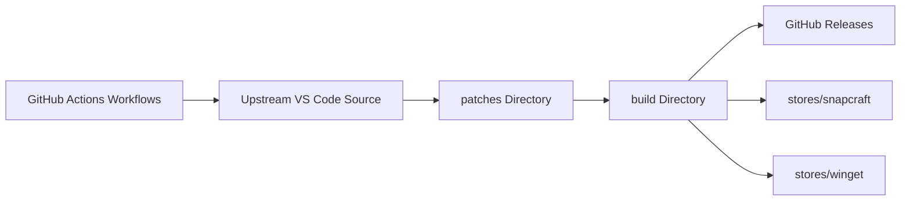

# VSCodium/vscodium

> VS Code binaries built without Microsoft's branding or telemetry, under the MIT license.

## The problem
Official VS Code builds are under a non-free license and collect telemetry data.

## What it actually does
It is not a fork: scripts clone Microsoft's repository, apply patches and a `product.json` without the Microsoft extensions, build for Windows, Linux and macOS (stable and insiders), then publish the binaries. Extensions come from open-vsx.org rather than the Microsoft Marketplace.

## How it is wired


## Trying it
```bash
brew install --cask vscodium
winget install -e --id VSCodium.VSCodium
snap install codium --classic
flatpak install flathub com.vscodium.codium
```

## Cost and gotchas
Free. Some Microsoft extensions (under a restrictive license) do not work with VSCodium; the README points to a list in its documentation. The build downloads a few pre-compiled extensions, Electron and ffmpeg.

## What it is not
Not a different editor from VS Code: it is the same code, without the Microsoft services. Builds stop as long as there is no new upstream version.

## Alternatives
No alternative named in the README (official Microsoft VS Code as the source).

## For you
Worth watching: if you want VS Code without telemetry, but check that your extensions (Python, notebooks, AI) are available on open-vsx.
