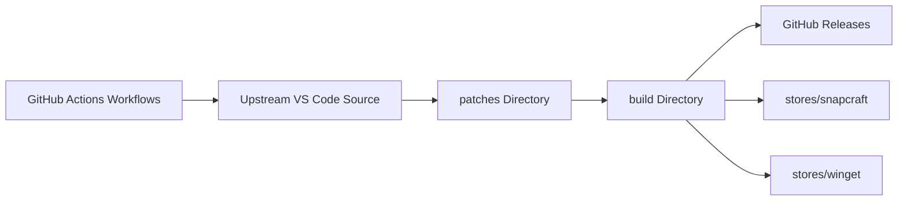

# VSCodium/vscodium

> Binaires de VS Code compilés sans la marque ni la télémétrie de Microsoft, sous licence MIT.

## Le problème
Les builds officiels de VS Code sont sous une licence non libre et collectent des données de télémétrie.

## Ce que ça fait vraiment
Ce n'est pas un fork : des scripts clonent le dépôt de Microsoft, appliquent des patches et un `product.json` sans les extensions Microsoft, compilent pour Windows, Linux et macOS (stable et insiders), puis publient les binaires. Les extensions viennent d'open-vsx.org plutôt que du Marketplace Microsoft.

## Comment c'est branché


## Essayer
```bash
brew install --cask vscodium
winget install -e --id VSCodium.VSCodium
snap install codium --classic
flatpak install flathub com.vscodium.codium
```

## Coût et pièges
Gratuit. Certaines extensions Microsoft (sous licence restrictive) ne fonctionnent pas avec VSCodium ; le README renvoie à une liste dans sa documentation. Le build télécharge quelques extensions pré-compilées, Electron et ffmpeg.

## Ce que ce n'est pas
Pas un éditeur différent de VS Code : c'est le même code, sans les services Microsoft. Les builds s'arrêtent tant qu'il n'y a pas de nouvelle version amont.

## Alternatives
Aucune alternative nommée dans le README (VS Code officiel de Microsoft comme source).

## Pour toi
À surveiller : si tu veux VS Code sans télémétrie, mais vérifie que tes extensions (Python, notebooks, IA) sont disponibles sur open-vsx.

