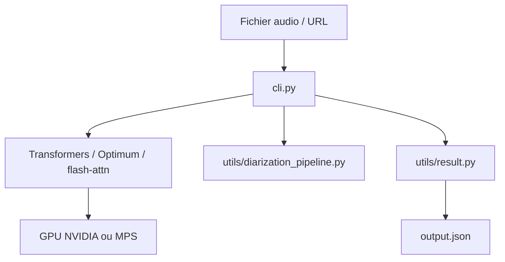

# Vaibhavs10/insanely-fast-whisper

> Local audio transcription command line with Whisper, optimized for NVIDIA GPUs and Macs.

## The problem
Transcribing long hours of audio with Whisper is slow without batching or optimized attention.

## What it actually does
A CLI calls Transformers and Optimum (Flash Attention 2 option) to transcribe a file or URL with Whisper large-v3 or distil-whisper, in batches, with per-segment or per-word timestamps, translation and speaker separation via Pyannote (Hugging Face token). The README shows 150 minutes in under 98 seconds on an A100.

## How it is wired


## Trying it
```bash
pipx install insanely-fast-whisper
insanely-fast-whisper --file-name <filename or URL>
insanely-fast-whisper --file-name <filename or URL> --flash True
pipx run insanely-fast-whisper --file-name <filename or URL>
```

## Cost and gotchas
Free, NVIDIA GPU or Mac required. On Mac, add `--device-id mps` and `--batch-size 4` to avoid memory errors. With Python 3.11, `pipx` may install a very old version: use `--ignore-requires-python`. Diarization: Hugging Face token.

## What it is not
Not a turnkey transcription service. The timings come from an 80 GB A100. Last push in October 2025, more than a year ago.

## Alternatives
The README compares against Faster Whisper (large-v2, 8-bit) in its measurements; no other repository named.

## For you
Worth watching: handy for local transcription if you have a GPU, but the repository is rarely updated and dependency versions may break.
