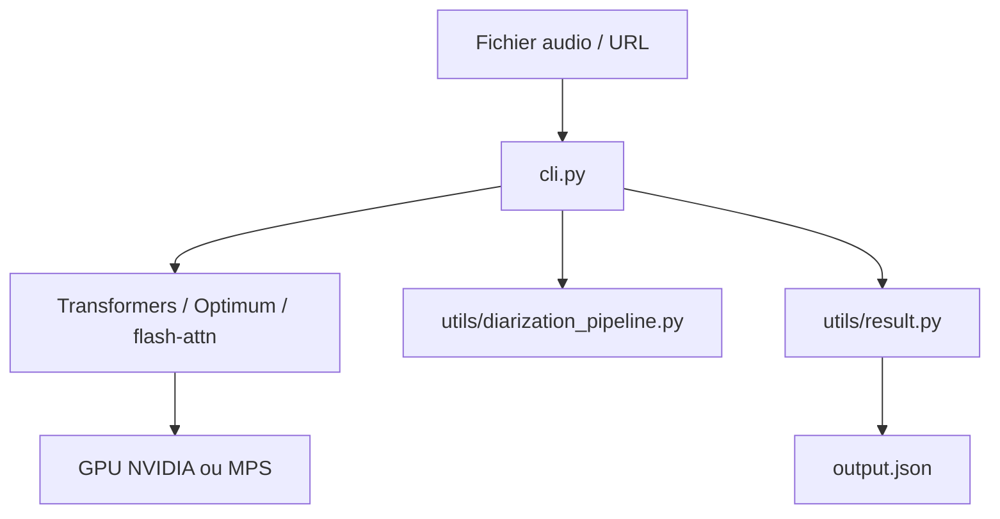

# Vaibhavs10/insanely-fast-whisper

> Ligne de commande de transcription audio locale avec Whisper, optimisée pour GPU NVIDIA et Mac.

## Le problème
Transcrire de longues heures d'audio avec Whisper est lent sans traitement par lots ni attention optimisée.

## Ce que ça fait vraiment
Une CLI appelle Transformers et Optimum (option Flash Attention 2) pour transcrire un fichier ou une URL avec Whisper large-v3 ou distil-whisper, par lots, avec horodatage par segment ou par mot, traduction et séparation des locuteurs via Pyannote (jeton Hugging Face). Le README affiche 150 minutes en moins de 98 secondes sur A100.

## Comment c'est branché


## Essayer
```bash
pipx install insanely-fast-whisper
insanely-fast-whisper --file-name <filename or URL>
insanely-fast-whisper --file-name <filename or URL> --flash True
pipx run insanely-fast-whisper --file-name <filename or URL>
```

## Coût et pièges
Gratuit, GPU NVIDIA ou Mac requis. Sur Mac ajouter `--device-id mps` et `--batch-size 4` pour éviter les erreurs de mémoire. Avec Python 3.11, `pipx` peut installer une très vieille version : utiliser `--ignore-requires-python`. Diarisation : jeton Hugging Face.

## Ce que ce n'est pas
Pas un service de transcription clé en main. Les temps viennent d'un A100 80 Go. Dernier push en octobre 2025, soit plus d'un an.

## Alternatives
Le README compare à Faster Whisper (large-v2, 8 bits) dans ses mesures ; aucun autre dépôt nommé.

## Pour toi
À surveiller : pratique pour transcrire en local si tu as un GPU, mais le dépôt est peu mis à jour et les versions de dépendances peuvent casser.

