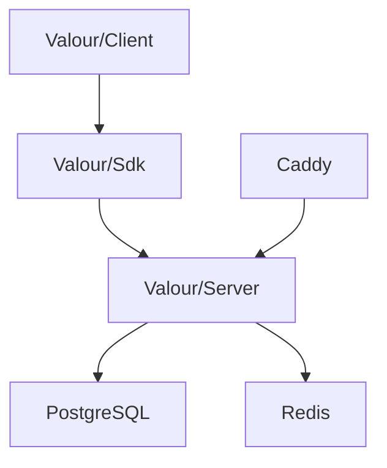

# Valour-Software/Valour

> Open-source community platform in .NET and Blazor: planets, chat, wikis, voice calls, federation.

## The problem
Community platforms are centralized at a single vendor; here you can host your own.

## What it actually does
Communities are "planets" with chat rooms, threads, wikis, voice and video, roles and an economy. The ASP.NET server exposes an API and SignalR, with PostgreSQL and Redis. A federation hub manages accounts and community nodes host the planets. Web, Android and Mac (MAUI) clients.

## How it is wired

Simplified diagram based on the fiche, no diagram provided.

## Trying it
```bash
cp .env.example .env
docker compose up -d
./scripts/valour-node-setup
dotnet workload restore
dotnet restore
dotnet run --project Valour/Server/Valour.Server.csproj
```

## Cost and gotchas
Public domain, ports 80 and 443, `DATAPROTECTION__KEK` key mandatory. Development requires the .NET 11 RC SDK (`11.0.100-rc.3`), PostgreSQL and Redis. AGPL-3.0: modifications served over a network must be published.

## What it is not
Not a data work tool. The name Valour is a trademark: forks cannot reuse it.

## Alternatives
No alternative named in the README.

## For you
Ignore: a chat platform unrelated to your work, and the preview .NET stack does not help.
