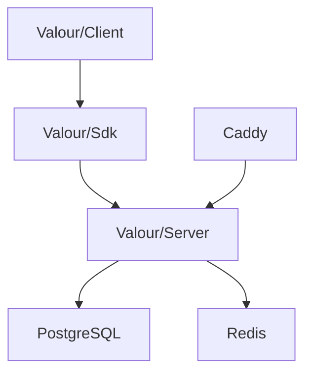

# Valour-Software/Valour

> Plateforme communautaire open source en .NET et Blazor : planètes, chat, wikis, appels vocaux, fédération.

## Le problème
Les plateformes de communauté sont centralisées chez un fournisseur ; ici on peut héberger la sienne.

## Ce que ça fait vraiment
Les communautés sont des « planètes » avec salons de chat, fils, wikis, voix et vidéo, rôles et économie. Le serveur ASP.NET expose API et SignalR, avec PostgreSQL et Redis. Un hub de fédération gère les comptes et des nœuds communautaires hébergent les planètes. Clients web, Android et Mac (MAUI).

## Comment c'est branché

Schéma simplifié d'après la fiche, sans diagramme fourni.

## Essayer
```bash
cp .env.example .env
docker compose up -d
./scripts/valour-node-setup
dotnet workload restore
dotnet restore
dotnet run --project Valour/Server/Valour.Server.csproj
```

## Coût et pièges
Domaine public, ports 80 et 443, clé `DATAPROTECTION__KEK` obligatoire. Le développement exige le SDK .NET 11 RC (`11.0.100-rc.3`), PostgreSQL et Redis. AGPL-3.0 : les modifications servies en réseau doivent être publiées.

## Ce que ce n'est pas
Pas un outil de travail data. Le nom Valour est une marque : les forks ne peuvent pas le réutiliser.

## Alternatives
Aucune alternative nommée dans le README.

## Pour toi
À ignorer : plateforme de chat sans lien avec ton métier, et la pile .NET en préversion n'aide pas.

