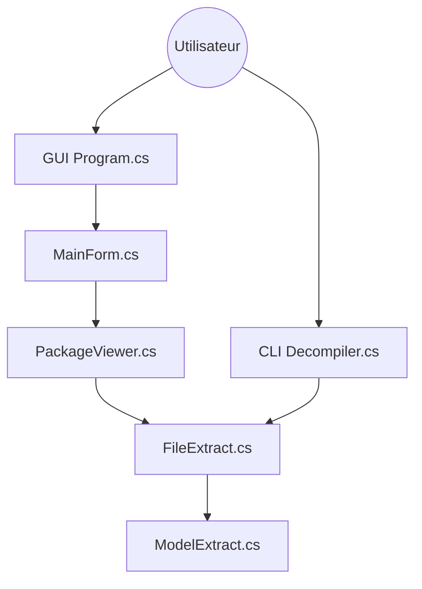

# ValveResourceFormat/ValveResourceFormat

> Viewer, command-line decompiler and .NET library for Valve's Source 2 game resources.

## The problem
Source 2 games ship models, textures, maps and sounds in compiled formats unreadable by the usual tools.

## What it actually does
Source 2 Viewer opens and previews these resources, then exports them to common formats. A CLI decompiler does the same extraction without an interface. The ValveResourceFormat library (NuGet) parses the files, and ValveResourceFormat.Renderer adds OpenGL rendering. A reference page lists what is readable and what is lost on export.

## How it is wired

## Trying it
No command documented: the README points to the website, the resource reading guide and the API reference.

## Cost and gotchas
Free. The code is signed via SignPath, as noted in the README. The graphical interface targets Windows (WinForms); the repository does not document other systems here.

## What it is not
Not a turnkey modding tool: export loses some data, listed in the formats reference.

## Alternatives
No alternative named in the README.

## For you
Ignore: video game tool unrelated to data/AI work, unless you need to extract 3D assets as a dataset.
