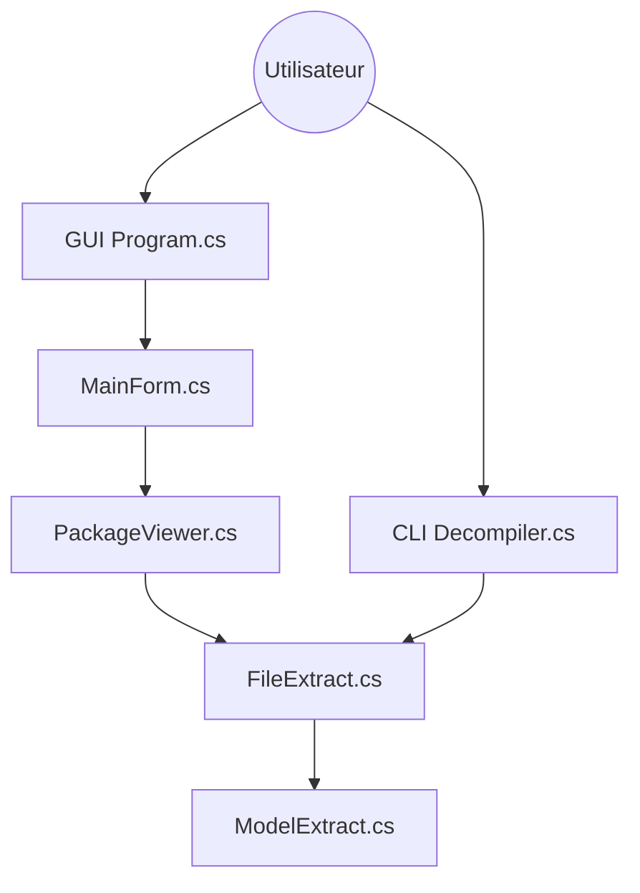

# ValveResourceFormat/ValveResourceFormat

> Visionneuse, décompileur en ligne de commande et bibliothèque .NET pour les ressources des jeux Source 2 de Valve.

## Le problème
Les jeux Source 2 livrent modèles, textures, cartes et sons dans des formats compilés illisibles par les outils habituels.

## Ce que ça fait vraiment
Source 2 Viewer ouvre et prévisualise ces ressources, puis les exporte vers des formats courants. Un décompileur CLI fait la même extraction sans interface. La bibliothèque ValveResourceFormat (NuGet) analyse les fichiers, et ValveResourceFormat.Renderer ajoute un rendu OpenGL. Une page de référence liste ce qui est lisible et ce qui se perd à l'export.

## Comment c'est branché

## Essayer
Aucune commande documentée : le README renvoie au site, au guide de lecture des ressources et à la référence d'API.

## Coût et pièges
Gratuit. Le code est signé via SignPath, signalé dans le README. L'interface graphique vise Windows (WinForms) ; le dépôt ne documente pas ici les autres systèmes.

## Ce que ce n'est pas
Pas un outil de modding clés en main : l'export perd certaines données, listées dans la référence des formats.

## Alternatives
Aucune alternative nommée dans le README.

## Pour toi
À ignorer : outil de jeu vidéo sans lien avec un travail data/IA, sauf besoin d'extraire des assets 3D comme jeu de données.

