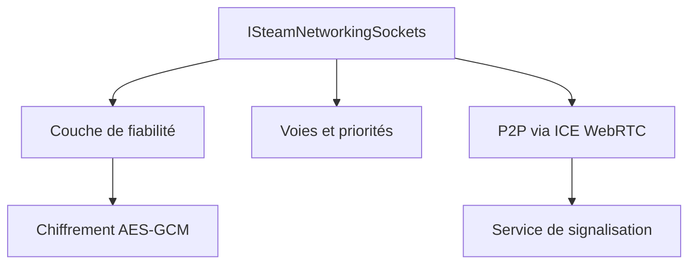

# ValveSoftware/GameNetworkingSockets

> Network transport layer for games: message-based connections, reliable or not, encrypted, peer-to-peer possible.

## The problem
TCP gets in the way of games (byte stream, head-of-line blocking) and raw UDP forces you to rewrite everything (reliability, encryption, fragmentation).

## What it actually does
Connection-oriented but message-oriented API, with reliable and unreliable messages, fragmentation, retransmission, AES-GCM-256 encryption and Curve25519 key exchange. Handles priority lanes, latency and loss simulation, IPv6 and peer-to-peer via WebRTC's ICE.

## How it is wired
Simplified diagram based on the sheet, no diagram provided.

## Trying it
No command in the README: see the BUILDING file to compile, and the examples example_chat.cpp and test_p2p.cpp.

## Cost and gotchas
Free, BSD-3-Clause license. Some features (authentication, signaling, SDR relay) exist only on Steam. The repository contains legacy code in an old style.

## What it is not
Not a game state synchronization library: no entity serialization, no compression. The name "Steam" does not mean Steam is required.

## Alternatives
No alternative named in the README.

## For you
Ignore: C++ game networking, unrelated to data, AI or MLOps work.
